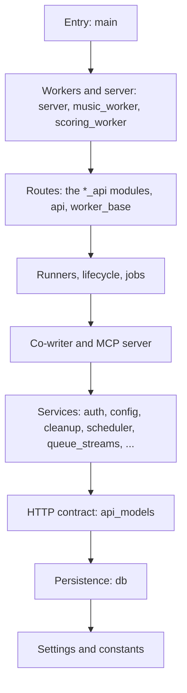

# Songmaker Architecture

## Overview

```
                    ┌─────────────────────────────────────┐
                    │        SvelteKit Frontend            │
                    │  Song editor, player, co-writer chat,│
                    │  generation settings, filters        │
                    └──────────────┬──────────────────────┘
                                  │ REST API (JSON)
                                  ▼
                    ┌─────────────────────────────────────┐
                    │        FastAPI Backend               │
                    │  Auth middleware → API endpoints     │
                    │  Pydantic request/response models    │
                    └──┬─────────┬──────────┬─────────────┘
                       │         │          │
                       ▼         ▼          ▼
                 PostgreSQL    Redis    Co-writer / judge providers
                 (all data)   (queues,  (selected provider per surface)
                              sessions,
                              rate limits)
```

## Docker Compose Layout

```
┌──────────────────────────────────────────────────────────────────────┐
│ Docker Compose                                                       │
│                                                                      │
│  ┌──────────────────┐   ┌────────────┐   ┌─────────────────────┐    │
│  │  songmaker-web    │   │  postgres   │   │  redis              │    │
│  │  FastAPI + Svelte │──▶│  all data   │◀──│  sessions, queues,  │    │
│  │  port 8080        │   │  port 5432  │   │  rate limits,       │    │
│  │  + control plane  │   │             │   │  worker state (TTL) │    │
│  └────────┬─────────┘   └────────────┘   └──────────┬──────────┘    │
│           │                                          │               │
│           │  enqueue jobs to named Redis queues       │               │
│           ▼                                          ▼               │
│  ┌────────────────────┐            ┌──────────────────────────────┐  │
│  │  music-worker       │            │  scoring-worker              │  │
│  │  no GPU             │            │  CPU (or GPU)                │  │
│  │  scheduler dispatch │            │  Whisper + AudioBox          │  │
│  │  queue: music       │            │  queue: scoring              │  │
│  │  max_jobs: 2        │            │  max_jobs: 1                 │  │
│  └──────────┬──────────┘            └──────────────────────────────┘  │
│             │ HTTP /load_model, /generate, SSE                       │
│             ▼                                                        │
│  ┌──────────────────────┐  ┌──────────────────────┐                  │
│  │  acestep-worker-0    │  │  acestep-worker-1    │ ← future GPU      │
│  │  GPU + ACE-Step      │  │  (added later, no    │                   │
│  │  subprocess          │  │   code change)       │                   │
│  │  /load_model         │  └──────────────────────┘                   │
│  │  /generate → SSE     │                                             │
│  │  registers w/ web    │                                             │
│  └──────────────────────┘                                             │
│                                                                      │
│  ┌──────────────┐  ┌──────────────┐                                  │
│  │  prometheus   │  │  grafana     │                                  │
│  │  scrapes      │──│  dashboards  │                                  │
│  │  /metrics     │  │  port 3000   │                                  │
│  └──────────────┘  └──────────────┘                                  │
└──────────────────────────────────────────────────────────────────────┘
```

ACE-Step worker pool: each `acestep-worker-N` is a peer container with its
own GPU. Workers self-register with the web container at startup
(`POST /api/internal/workers/register`) and heartbeat ephemeral state to
Redis with a 15s TTL. The music-worker is now a thin orchestrator: its
arq `generate` job calls the scheduler (`scheduler.py`), which picks an
online worker, INCRs queue depth atomically, dispatches via HTTP, and
consumes the worker's task SSE stream until `done`. A stream that stays silent
for 630 seconds retains `Worker stream went silent` as its logged diagnosis; transport
drops still use the scheduler's bounded reconnect policy. Failed model loading,
no running music worker or online ACE-Step worker at admission, unreachable workers, a mode still missing after one reload, stream silence, and
exhausted reconnects show musicians “Generating isn't available right now.”
Typed GPU-memory failures show “Too long for the GPU right now — try a shorter duration.”
while remaining takes continue.
The [failure contract](acestep.md#failure-cause-contract) defines classification
and persistence. The music-worker then
post-processes the worker's WAV (decode → splice → master → MP3 → DB
insert) and the job completes. See [acestep.md](acestep.md) for the
worker API surface.

Production application containers (web, music-worker, scoring-worker, and ACE-Step workers) write JSON log lines with `timestamp`, `level`, `logger`, and `event`; Docker retains five 10 MB files per service so operational history remains bounded.

## Job Routing

```
User clicks "Generate"                    User clicks "Score"
        │                                         │
        ▼                                         ▼
  POST /songs/{id}/generate               POST /generations/{id}/score
        │                                         │
        ├── rate limit check                      ├── rate limit check
        ├── ownership check                       ├── ownership check
        ├── create Job record                     ├── create Job record
        │                                         │
        ▼                                         ▼
  arq:queue:music                          arq:queue:scoring
  (Redis sorted set)                       (Redis sorted set)
        │                                         │
        ▼                                         ▼
  Music Worker (orchestrator)              Scoring Worker
  ├── see [Generation Flow](#generation-flow) ├── spawn scorer subprocess
  │   for Lua admission, hold defer, config   ├── Whisper transcription
  │   build, worker HTTP, and persistence      ├── AudioBox aesthetics
  │                                              ├── BPM, dynamics, silence, spectral
  │                                              ├── lyrical coherence (configured judge provider)
  │                                              ├── save scores to DB
  │                                              └── Job status: completed
  ├── post_process_generation (to_thread):
  │   ├── read worker WAV from volume
  │   ├── decode + splice (if repaint)
  │   ├── master → MP3 + ID3 tags
  │   └── INSERT generation + `generation.created` event (one DB transaction)
  └── Job status: completed

  Repaint: POST /generations/{id}/repaint
  Cover:   POST /generations/{id}/cover
  Upload:  POST /api/audio/upload (reference audio)
  Art:     POST /api/albums/{id}/cover and POST /api/songs/{id}/cover (files on the audio volume)

  User clicks "Chat"
        │
        ▼
  POST /api/chat/turn
  (multi-turn: loads history from DB,
   compacts it to a rolling summary plus a token-bounded tail,
   runs one run of agents/cowriter.md at the agent service,
   relays its events as SSE frames,
   stores user + assistant messages)
```

Newly generated audio (MP3, WAV) and generated album covers (the suggestion PNG and every published cover file after USE) carry the IPTC digital source type `trainedAlgorithmicMedia` as machine-readable metadata; an uploaded cover is not AI-generated and does not.

## Layers

### Frontend (`frontend/`)

SvelteKit single-page app. All state in Svelte stores.

**Ruled, not yet built (#1354).** The picture and the 41 rules the operator
ruled on 15.10.2026 stand in state (i) of `docs/design/navigation.html`. They
govern the phone shell, the library wall and its sort, and the `PlayerBar`
described below. Until #1354's slices land, this section describes what runs.

The app shell is one navigation, not modes. A left `Rail` (264px, inline on
wide layouts) holds: the brand (the rail's shortcut to Home, `openHome`)
pinned at the top; a scroll container in the middle holding the LIBRARY
group, built on the shared `RailGroup.svelte` (chevron, icon, label, count —
one row shape for every group); and, on the desktop only, pinned below that
scroll container, the SETTINGS group (also a `RailGroup.svelte`, via
`RailSettings.svelte`); the rail has no account row. On ≤768px or any coarse pointer, `PhoneTabs` provides Home,
Library and Playlists in desktop order. `+layout.svelte` derives their pathname
from `standingPathname(page.state)` and mounts them only for signed-in private
pages outside song routes, while the transport is visible. Settings and `/loras`
keep the tabs with none selected; album detail selects Library. The layout
owns `html[data-phone-tabs]` and removes it on unmount. Home uses `openHome`;
Library and Playlists reuse `openRailSearchTarget`, including its no-op for
an already visible destination. The phone app bar (`PhoneAppBar.svelte`,
frames I2–I4) carries no drawer trigger. Every page but Home, Library and Playlists carries
‹, named after the page below it in the tab's history. `routes/standingAddress.ts`
reads that standing page; `routes/pageBack.ts` owns the shared visibility and
naming decisions, including desktop's requirement for a page below. With nothing
below, the phone names the song's album, Settings for a Settings section,
Playlists for a playlist, and Library otherwise. `navigation.ts#stepBackFromPage`
chooses that domain fallback and delegates traversal to the history controller's
`stepBackOr` / `stepBackOrGoTo`. Cold Settings replacement is counted by the
controller; library walls restore their stores through the private
`openListOverPage`. Cold song Back uses `backToCollection`, whose promise awaits
the guarded replacement when it executes. Both song traversal and fallback reuse
the existing dirty-draft question; a parked action resolving does not mean the
person has agreed to leave. 🔍 on every page
opens the one search, `RailSearch`, in a sheet. The Library and the Playlists page carry the brand
and a 44px account circle at the right edge (the desktop: top right of the main area). Its menu
(`AccountMenu.svelte`) holds the name (opens `/api/auth/me`'s `account_console_url` in a new tab),
Settings, the theme switch, Sign out and a quiet row of legal links; the song carries its title,
share and song menu instead. Choosing
Settings in the account menu while `/settings` is already on screen only
closes the menu.
In the LIBRARY and PLAYLISTS groups the word is a link to the group's own list
page (`/library`, `/playlists`) and the caret beside it is the only fold control
(#1354 rule 40); there is no "All albums" row. On its own page a group is
the current page and opens, as drawn in `docs/design/navigation.html`.
`RailLibraryGroup.svelte` is the LIBRARY group: it
loads every album route-independently (`ensureAllAlbumsLoaded`, #304) and
lists all of them, each expandable one level into its own tracks (a
takes/pick summary per row, an equalizer marking the one actually playing, a
crimson left border marking the selected/current track). The row of the album
or playlist whose own page is on screen is the current page
(`aria-current="page"`): a purple `--accent` bar, tint and bold name that
outrank hover, styled once in `RailGroup.svelte` for both groups (#1371). The
wall and Home keep the last-open collection but mark no row. That row scrolls
into the rail's view (`revealOpenRailItem` in `rail-item-selector.ts`) each
time it becomes shown — a navigation, Back, a reload, its group opening, a
search clearing — once the group has finished opening, and not again while it
stays shown. The open album's row and its
selected track pre-expand automatically on entry without overriding a later
manual collapse. There is no Studio/Listen mode split and no third library
tab for
Shared. Home (`LibraryHome.svelte`, `/`) is its own page: the head "Home" and
Listen (`HomeListen.svelte`: up to three Library rows from the shared
`stores/libraryOrder.ts` Listen read), with no wall. Listen retains rows when
offline and offers Retry when its first read fails. The live collection stores
hide deleted or archived places; restoring an album reveals its retained row.
Write (`HomeWrite.svelte`) follows Listen, showing the server's three distinct
worked songs through `stores/libraryWrite.ts`. Its Library rows and pencils
open the editor, with album context, work kind and relative time. Mount reuses
a fresh document-memory answer; foreground and reconnect explicitly invalidate
and refresh it. Subscriptions belong to the mounted surface and are cleaned up.
Cached rows (including empty results) survive failed refreshes; a failed first
read offers Retry. Removal excludes stale in-flight answers until they settle;
Undo consumes recognition separately and requests an authoritative fresh read.
Confirmed logout/session loss replaces the document; Write has no persistent cache.
Both lists render through `HomeListSection.svelte`, which owns the heading and the
loading, failed (with Retry), empty and rows states; each list keeps its own reader.
Home's head line holds the one + New (`NewPlaceMenu.svelte`: the button, its
Album · Playlist popover and the inline card that unfolds under the head) at
both widths; the desktop Library and Playlists heads mount the same component,
the phone's list heads do not (#1354 rule 14, #1529).
`LibraryWall.svelte` (the main-area library browser, `/library`) shows one wall
of albums alone, without Listen
(`kind="library"`; the Playlists page mounts the same component as
`kind="playlists"` for a wall of playlists alone), with no filter chips
(#1102; state (g) of `docs/design/album-browsing.html` as blessed 27.09.2026
for #1071, rewritten by #1354 rules 7 and 9). The head line reads the page
name and its count once loaded ("Library · 12"), then one switch, A–Z · Last
played, and on the desktop the + New menu; an empty wall says so in one line
that points to Home's + New ("No albums yet. + New on Home makes one.", "No
playlists yet. + New on Home makes one."), and the rail's groups stay with 0
items. A first visit opens in A–Z and the choice is
remembered on this device (`libraryWallOrder` in `stores/ui.ts`; a stored
order it does not know, such as an earlier Recent or Added, opens in A–Z).
A–Z compares titles ignoring case and accents and
reads numbers by value, so "Demo 2" precedes "Demo 10" (one
`Intl.Collator` in `utils/recency.ts`); Last played is the rank
`/api/library/listen` gives each place, read in pages of 200 until a short
page, so every place the viewer listened in is ranked by that one listen fact
and there is no second rule (a place the viewer never listened in has no rank
and waits at the end in title order). One owner, `stores/libraryOrder.ts`,
holds these comparators and the Last played ranking; the wall and the rail's
albums and playlists (desktop rail and library walls) all ask it, so the switch
reorders both at once. It starts one Listen read per page load however many
readers ask. Under Last played a page holds its places back until that read
answers (the wall shows the loading word, the rail groups stay empty) and falls
back to A–Z if the read fails. The player calls `outdateLastPlayedRanking` once
a listen's POST has resolved, so the next showing of the wall reads again; a
restored take records no listen and outdates nothing. Each tile's second line
follows the order: the size under A–Z, the last listen under Last played (the
size for a place never listened in). Back or ‹ from an album's or a playlist's
page lands the wall at the scroll its entry kept, and on the phone the row of the place just left
lights up once (#1354 rule 12): `setLibrarySurface` remembers the place when the
wall replaces its page, `takePlaceReturnedFrom` hands it to the one showing of
the wall, and the first `LibraryRow` to show that place tints it for a moment (a
still tint under `prefers-reduced-motion`) and reports it lit, which spends the
light for that showing, so a remount of the row never repeats it. The light
also follows the rail's Library link, and Back from a song page lights that
song's album. The desktop tiles land the same way without the light. The wall
moves `scrollTop` only when it is not already at the anchor, so the anchor its
own scroll reports never cuts into a momentum scroll. The wall sorts the
complete set from the same route-independent loader the rail uses
(`ensureAllAlbumsLoaded` in `stores/libraryData.ts`). A browse reset, which
history navigation (Back and Forward, an address, returning to the
wall) and a live stream reconnect run, reads only the first album page; once
a surface asked for every album, that page refreshes the albums it holds and
the rest stay (`resetAlbumList`), so neither surface shrinks to one page and
no navigation reads every album again. Navigation therefore never removes an
album, and albums changed on another device past that first page show their
change only later: a stream snapshot that follows a gap (a resync, or a
bootstrap after a failed one) reads every album again and replaces the list
(`rereadAllAlbums`), so one deleted or archived elsewhere leaves then or on
the next page load.

An open album has an address of its own, `/album/<slug>` (issue #269; album
ids are already readable slugs), an open song one segment deeper,
`/album/<slug>/<song-slug>` (issue #275; songs carry their own album-unique,
DB-enforced slug — issues #272/#274), a selected take one segment deeper
still, `/album/<slug>/<song-slug>/take/<n>` (issue #281), where `<n>` is
`generation_number` — the number the surface already shows the person ("Take
3"), never the generation's uuid — and an open playlist an address of its
own, `/playlist/<slug>` (issue #286, #265's S5 and last new address of the
chain): a sibling of `/library`, not a segment under `/album/<slug>`, since a
playlist has no album to nest inside — its `slug` follows the album
precedent (a globally unique column, reserved via `unique_playlist_slug` in
`api_helpers.py` under its own advisory lock, `_PLAYLIST_SLUG_LOCK_ID`) rather
than a song's per-album one. The Playlists page has an address of its own as
well, `/playlists` (#1402): the wall of playlists alone, which the library
shows as its `playlists` surface beside the wall's `browse`; it names no
resource, so its route resolves nothing and states no verdict. Home and the
Library are two addresses as well (#1506, #1354 rule 31): `/` is Home, with
the library's `home` surface, and `/library` is the wall, with its `browse`
surface; neither names a resource, `/library/x` is `external`, and
`routes/addresses.ts` is the one owner of both paths. All seven of `/`,
`/library`, `/playlists`, `/album/<slug>`, `/album/<slug>/<song-slug>`,
`/album/<slug>/<song-slug>/take/<n>` and `/playlist/<slug>` sit inside the
`routes/(library)` route group, whose own
`+layout.svelte` mounts `components/LibraryWorkspace.svelte` — the bootstrap
gate and the surface switch — exactly once for as long as the browser stays
on any of the seven (issue #276); the route files underneath are thin, each
resolving its own address and rendering only an overlay (loading / unknown /
unreachable) stacked over the standing workspace while it does. Before #276
each mounted the workspace itself, so a crossing between any two swapped the
leaf `+page.svelte` and tore the component down with it — the sync stream
survived (`routes/+layout.svelte`, next paragraph) but the workspace, and
everything under it (`SongDetailView` included), did not; measuring the cost
(issue #275, then #276) is what forced the route group. The outer
`routes/+layout.svelte` still owns the live event stream and the history
listener, so swapping between any of the seven addresses neither rebuilds the
workspace nor re-runs its bootstrap, and it starts the stream only for a
signed-in browser on a library route — the reach the workspace page had when
it owned this; Settings, login and the share pages leave it off. The
workspace itself gates on `resourceSync.ready` rather than on a promise
resolved once per mount, so a mount that finds the stream already live
(returning to the library after leaving it) shows the library on its first
frame. `libraryHistoryUrl` in `stores/libraryContext.ts` maps library state to
one of the seven: an open song addresses `/album/<slug>/<song-slug>` once the
song's slug is known from `songList`, a selected take addresses one segment
deeper still, `/album/<slug>/<song-slug>/take/<n>`, once that take's
`generation_number` is known among the song's loaded generations — a take
selected before its number is known keeps writing the `?gen=…` appendage
until it is (a search hit or a playlist row opened by id alone, before its
own upsert into `songList` lands — see `libraryHistoryUrl`'s own comment) —
an album that is the visible surface but has no song open addresses
`/album/<slug>`, an open playlist addresses `/playlist/<slug>` once its slug
is known from `playlistList` (`openPlaylist` in `navigation.ts` awaits
`ensurePlaylistsLoaded` before pushing history precisely so this is already
true by then; a playlist opened before its slug is known — the same rare
in-flight gap a song's legacy `?song=` form covers — falls back to `/library` rather
than a broken address, since a playlist never had a legacy form of its own to
fall back to), the Playlists page addresses `/playlists` whichever collection
stays the rail context behind it, Home addresses `/` and
the wall `/library`, and an album or playlist that is only the rail context
behind either stays on that address (only an album's own detail addresses
`/album/<slug>`). The legacy `/?song=<id>[&gen=…]` form a pre-#275/#281 bookmark
or shared link still carries is no longer read as its own entry point:
`(library)/+page.svelte` resolves it (`resolveLegacySongQueryAddress` in
`stores/libraryContext.ts` — one `fetchSong` call gets both the slug and,
when `?gen=` names a generation the song still has, its `generation_number`)
and redirects, `replaceState`, onto the canonical song or take address —
issue #284 — so Back does not step back through the query form, and an
unknown song id gets the same honest 404 treatment `openSongAddress`'s
unknown-song case does rather than a silent landing on the wall. Home's route
calls `openHomeAddress` only when the query names no song, so a legacy address
is never written over with `/` while its lookup is in flight (#1506); the
Library's route ignores `?song=` altogether. An unknown `?gen=` on an
otherwise known song is dropped rather than 404ed — the song still exists,
and takes are pruned by ordinary cleanup, so a dead take is not the song's
own failure — but not silently: dropping it without saying so would still
hide a fact the surface knows, so the page toasts
`LEGACY_TAKE_LINK_NOT_FOUND_TOAST` once the redirect has landed on the song
address (never before — the bar must already read the new address when the
toast explains why it isn't the take one). A tab whose history entry
already names this exact legacy entry (a song not yet in `songList` when its
address was written keeps the query form as a same-shape fallback —
`libraryHistoryUrl`'s own comment — so a later Back/Forward can return to
one) has `onPopstate` apply that state instantly from its history entry; the
page checks for exactly this before resolving anything itself and, when it
matches, skips its own network round trip and the overlay entirely rather
than re-resolving the same address in parallel (issue #265's S7 closed the
double-resolve this way, once removing the hand-built router guard below
made writing this check the smaller fix — no other read of the entry
here needed it, so it stayed a known, self-healing race until then).
`isLibraryWorkspacePath` still counts all seven by pathname (every address
`libraryRouteShape` in `routes/addresses.ts` gives a library shape) rather
than by the route group, since `routes/+layout.svelte` sits outside
`(library)` and needs the same seven addresses for its own, separate reach
decision (starting the live event
stream) — the only remaining reader of it: #264's own guard,
`ensureLibraryWorkspaceRoute`, forced every collection/song open onto one of
these five paths before writing its history entry, which S7 proved
redundant and removed once `writeLibraryHistory`'s own crossing check
(`libraryRouteShape`, below) covered leaving *any* non-library route,
Settings included, not just crossing between two library addresses — see the note
on `LibraryRouteShape`'s `'external'` shape in `routes/addresses.ts` for
why that shape has to exist for the guard's removal to be safe, and
`navigation.test.ts`'s "opening a collection from off the library route"
suite for the per-entry-point proof. A cold tab opened on an album, song,
take or playlist address resolves it against the API first (`openAlbumAddress`
/ `openSongAddress` / `openTakeAddress` / `openPlaylistAddress`): an unknown
album slug, an unknown song slug within a known album, an unknown take number
within a known song, or an unknown playlist slug is stated as such — the song
case links back to the album, the take case links back to the song, never to
the Library or Home — instead of falling back to the wall, and a known
address is written into the library's own restore state, so it is restored by
`hydrateLibraryFromHistory` — the same path a reload and Back take — and stays
present even when it is not on the first browse page. Resolving a take number
needs every one of the song's generations loaded, not just whatever the
album/song listing carried along, so `openTakeAddress` runs
`ensureGenerationsLoaded` (`stores/player.ts`) before it looks for the number;
`openPlaylistAddress` has no such second lookup — playlists carry no
pagination, so resolving the slug against the one list call either finds it
or the address is unknown. A cold tab on `/`, `/library` or `/playlists` looks nothing up:
`openHomeAddress`, `openLibraryAddress` and `openPlaylistsAddress` (one private
`openSurfaceAddress` behind the three) only write the `home`, `browse` or
`playlists` surface into the restore state, unless the entry a reload came back
onto already shows it, and they leave the listing to the live stream's snapshot
(a cold tab loads it once, not once for the address and once more for the
snapshot). An entry a tab kept from before #1506, `{browse}` at `/`
(the wall used to stand there), reads as Home: `libraryHistoryEntry` is the one
reader of every entry, the current one and the one a popstate lands on alike,
and the address the entry stands at decides what it says (`entryForAddress`),
so the entry keeps its collection and loses only the wall's scroll, in whichever
order the route and the live snapshot finish. A later Back or Forward through
it reads Home too; only `currentLibraryHistoryState()`'s held write, a `{browse}`
push to `/library` whose address has not moved yet, is read as written.
`manifest.webmanifest` keeps `"start_url": "/"` as the one static exception to
`routes/addresses.ts` owning both paths: JSON cannot carry a comment, the value
is Home by rule 31, and `server.py` and the service worker hold no route list
that could follow `HOME_ROUTE_PATH`.
`writeLibraryHistory` in
`stores/libraryContext.ts` is the single owner of every library history
write, and every write goes through SvelteKit's router (issue #1165), so each
entry carries the router's own place in history and Back or Forward between
the library and any other page — Settings included — navigates instead of
only moving the address bar, provided the page was pushed onto a library
entry rather than written over a history layer's (`openAppPage` waits for
pending history steps to land; see "Back closes the open layer first"). A write that crosses between two route files is
a navigation: `goto`, carrying the library as its page state
(`App.PageState.library`). The library shows the new page the moment its
stores change, while `goto` writes its entry only once the route has loaded, a
task later, so a crossing pushed from a library page first installs its entry
by shallow routing and its `goto` then mounts the route by writing that entry
over again; otherwise a Back pressed in between skipped an entry (album, song,
Back showed the wall). A mount is no queued step: a newer navigation
supersedes it and a Back aborts it, so a song tapped while its album's route
still loads installs its own entry at once too, a crossing queued behind a
step back (Go to song leaving a history layer)
installs its entry the moment that step lands, and a write that keeps the
route meanwhile re-issues the mount for the entry now standing. Such an entry
shares the navigation index of the library entry under it, so Back and
Forward between the two are shallow and keep the mounted route. An address
its route states as unknown or unreachable, or one still loading, has written
no library entry, so a crossing from it stays one `goto` push with its own
navigation index, and Back onto it loads its route again and states the
address once more instead of showing the wall. The frequent
same-*shape* churn — filter, sort,
scroll, search cursor, another song of the open album (#275), another take of
the open song (#281), another open playlist (#286), a history layer over the
library — is shallow routing (`pushState`/`replaceState` from
`$app/navigation`): synchronous, no route resolution. `libraryRouteShape`
(home / library / playlists / album / album-song / album-song-take / playlist / external) is what
the crossing check compares — only the route-file depth decides a crossing,
never which resource the address names, and `/playlist/[slug]` is one route
file whichever playlist it names. The eighth shape, `external`, is everything
outside the seven library addresses, so leaving Settings, login or a share
page always crosses; it is what let issue #265's S7 delete
`ensureLibraryWorkspaceRoute` (#264's separate guard). Shallow routing keeps
the page's route and `page.url` where the last navigation left them, and an
entry it writes remembers that page: Back onto it from another page loads
that page's route, whose params can name a page the address bar does not
show (a second album opened over the first, then Settings, then Back). The
address resolvers (`openAlbumAddress` and its siblings) therefore let such an
entry win and apply it as it stands (`entryOutranksStaleAddress`). Nothing
reads the library from `page.state` or `page.url`: `onPopstate` unwraps the
entry it lands on with `libraryHistoryEntry`, and every other reader asks
`currentLibraryHistoryState()`. A 10-song Next sweep writes one
`replaceState` per step and navigates never, so the layout and the address
pages do not re-render for it. SvelteKit's start writes its own entry over
the one a page loads onto, dropping the library a reload comes back to, and
shallow routing may not run before that start is over: `libraryContext.ts`
reads the entry's library once while the router loads it,
`routes/+layout.svelte` holds every library write
(`holdLibraryHistoryUntilRouterStarts`) until the router reports its first
navigation, and the first write puts that library back onto its entry.
Crossing writes are asynchronous and therefore serialized, and
`currentLibraryHistoryState()` — not `history.state` — answers what the entry
will be (the held reload state included), so a caller that writes twice in a
row (open a song, then pin its take — itself a second crossing, queued behind
the first) is not read against a stale entry. A rename changes a song's or a playlist's slug
server-side (`unique_song_slug` / `unique_playlist_slug` in `api_helpers.py`);
the song view's own rename call writes the renamed song back into `songList`
like any other song edit, and a slug-only change on the currently open song is
what pulls its address along (`navigation.ts`, `syncSongAddressToRename`) —
this also covers a rename while a take of that song is addressed, since
`isSongRoutePath` reads true one segment deeper too — and `syncPlaylistAddressToRename`
mirrors this for the currently open playlist, subscribed to `selectedPlaylist`
(derived from `playlistList` + the open collection) rather than a song-list
upsert, since a playlist rename already writes its own row back into
`playlistList` via `updatePlaylistInList`. An ordinary edit (lyrics, prompt,
cover, entry reorder) does not re-touch either address, and a still-legacy
`/?song=…` address is left alone rather than upgraded mid-session.

The single source of navigation truth for "what collection is open" is the
leaf store `stores/collection.ts` (`openCollection: {kind: 'album'|'playlist',
id} | null`), which nothing but `openAlbum`/`openPlaylist`/history restore in
`stores/navigation.ts` and `loadPlaylistDetail` in `stores/playlists.ts`
write. `playlists.ts`'s `selectedPlaylistId` is derived from it, not
independently writable. Opening a song — whatever the entry point (rail row,
search hit, a redirected legacy `?song=` link, history restore) — always leaves the rail
context pointing at that song's album: a module-level subscription in
`navigation.ts` sets `openCollection` to the song's album whenever it doesn't
already match, so the album is never unreachable while a song is open (the
#93 defect this shell replaces). `selectedAlbumId` in `stores/player.ts` is a
separate, narrower concept — the open *song's* album, used by the editor and
queueing — never written from `openCollection`.

A collection interior (`AlbumDetailView` / `PlaylistDetailView`) shares one
header, `CollectionHeader.svelte`: cover, title, subtitle, a primary Play
action, and a single `…` menu (`CollectionMenu.svelte`). `CollectionHeader`
itself is a thin wrapper around `CollectionHeaderFrame.svelte` — the
presentational cover/Play markup with no store or auth coupling — so the
share surface (below) can reuse the identical frame with a plain title in
place of `EditableTitle`/`CollectionMenu`. There is no visible
Share icon — the menu's first line names the object ("Album · <title>" /
"Playlist · <title>"). The album menu then has exactly seven rows, each a
bare verb with one icon: Edit details · Cover · Pick album takes · Add to playlist ·
Share · Archive · Delete (red, last). Edit details opens `AlbumMetaEditor`
in place of the title, where title, subtitle and year change together;
Cover opens the album's cover editor (`AlbumCoverEditor`) in place of the
cover, which owns upload, suggestions and removal. One store,
`stores/coverActivity.ts`, owns the open album's cover state for both the
editor and the mark on the closed cover (a ring and the time while a
suggestion runs, "● n waiting" while unused ones wait until USE, Upload or ×
discards them). It reads the server's state when the album page opens, when the
page returns to the foreground, when the editor opens or closes, when a run ends
and after a discard, never
by polling, so a second tab or device sees the same run and its time. Playlist entries are
Share playlist · Upload… · Remove cover (only when a cover is set) ·
Rename · Delete playlist. The Share row is a 44 px menu row that
shows its state ("on"/"off", a link or share icon, `aria-pressed`); it and
`ShareButton` both call the one toggle, `createShareToggle` in
`stores/shareToggle.svelte.ts` (unshare, share and copy the link, toasts, the
busy guard), so none of it is reimplemented; a playlist's Rename forwards to
the same `EditableTitle` click affordance the title itself uses
(`EditableTitle` exposes an imperative `startEdit()` via `bind:this` for
exactly this). Under the title
the header reads how many songs the page lists; it carries no breadcrumb and
no shuffle, because shuffle is the player's (#1354 rule 24), and its Play
turns that shuffle off to play from the top. Every song box on both pages is
one component, `SongRow.svelte`, which imports no store: a tap anywhere on
the box plays it in place, and its `✎` opens the song in the editor
(`selectSong`), the one way from either page to the editor; a surface
without the editor passes no `✎`. An album song plays through
`playAlbumSong`, which starts the album at that song with the whole album
queued around it — Next continues in album order, or in the player's
shuffle when it is on — and an album song with no take yet opens the editor
on the tap instead (#1354 rules 22–23). A playlist row is a take and plays
through `playPlaylistEntry`; it shows the take's duration and version and a
`★` when it is that song's picked generation
(`PlaylistEntryResponse.version_number`/`is_picked`/`audio_duration`, sourced
from the entry's generation and its version), and its `…` menu carries Move
up · Move down · Remove from playlist. `SongDetailView` shows a
`Breadcrumb`, `Library › <album title> › Track <n> of <m>` (falling back to
the song's own title when it is not part of a countable album track list);
each crumb before the current one is a button that jumps straight back to
that level (`openLibraryWall` / the open collection).

`PlayerBar` is transport-only: shuffle, prev/play/next, a 44px cover,
title/subtitle, the seek bar, and a "Now Playing" word-button with an
up-chevron. That button is a dialog trigger while Now Playing would open full
screen and a plain disclosure toggle while the docked panel is showing —
pressing it again puts the panel away (issue #140), which is why
`TransportBarFrame` takes `nowPlayingDocked` and drops `aria-haspopup` for it.
The bar itself steps aside under the full surface on every viewport: "one
player, never two" means the full-screen Now Playing carries the only
transport, so `PlayerBar` renders no `TransportBarFrame` while
`nowPlayingSurface` is `'full'`. `--player-height` is the single fact behind
that: it means "the room the transport bar takes right now", and `app.css`
owns every one of its values — the resting 88px, the 64px compact/coarse
overrides, and `html[data-transport-bar='hidden'] { --player-height: 0px }` for
while the app's bar is hidden. With phone tabs mounted, `--shell-bottom-offset`
is `--phone-tabs-room` (54px plus the safe-area bottom), and
`--transport-safe-area-bottom` becomes zero: the tabs own that inset once.
Without tabs, the transport owns the inset. The layout's hidden attribute
excludes public routes, even with retained signed-in/player state.
Tabs and transport step aside under the full surface, or while a field has
focus on the phone and the keyboard takes the bottom. That last rule ties with
`html[data-pointer='coarse']` on specificity and wins on source order; `+layout.svelte` owns only the attribute it keys on. Everything that reserves space for the bar — the shell
rows, `ToastContainer`, `QueueStreamFeedback`, the editor's bottom padding,
the collection views and Now Playing's own sheet — follows from it instead of
carrying its own exception. A share page keeps its bar and never carries the
attribute, so `SharedFooter`'s `var(--player-height, 88px)` stays as it was;
a shared song or take has no bar at all, and its page sets
`--player-height: 0px` on itself. Because the bar unmounts, it cannot own the Web Audio graph: an `<audio>` element can be passed to `createMediaElementSource` exactly once, and closing the context that owns that source routes the element's output into a dead graph for the rest of the session — playback that still reports itself as playing but makes no sound. `audioPlayer.svelte.ts` therefore owns the context and the analyser for the elements' whole life (`getAnalyser`, `resumeAudioGraph`, closed only in `destroy()`, built lazily so a device that never draws a visualizer never routes its audio through Web Audio), and `TransportBarFrame` only borrows the `AnalyserNode`. The player holds two elements, an active deck and a standby deck, each with its own `MediaElementSource` into the one context: `preload(info)` loads the standby, and `load()` promotes it without waiting for `canplay` when it holds exactly the requested URL with future data, so the analyser carries whichever deck is playing. The transport chrome and visualizer live in `TransportBarFrame.svelte`, a
presentational component driven by props plus the `audioPlayer` singleton
directly (never a store) — `PlayerBar` supplies the app's idle-state copy,
store-derived prev/next, and its own media-session position/playback-state
wiring; the share surface's `SharedCollection.svelte` drives the same frame
from its own `SharePlayback` owner instead, with no media-session wiring of
its own. `idlePlayTarget` (in `stores/player.ts`)
now takes the single `openCollection` instead of the old
`albumId`/`songId`/`playlist` tuple, so a song open inside an album keeps
that album as the idle Play target instead of falling back to the library
pool. A playlist opened while its detail is still loading stays the idle
target too: Play joins that load (`loadPlaylistDetail`) and starts the
playlist once it arrives — never the library, never the list just left. Per-track queue-skip feedback (`QueueStreamFeedback`) and the take-pool picker
live inside the `NowPlaying` surface, not the bar; shuffle is transport and
sits in the desktop bar and in Now Playing (issue #141), labelled from the
single `shuffleLabel` derived so the two can never disagree about the scope
they would shuffle. At ≤640px viewport width or any coarse pointer, the bar
collapses to one 64px mini-player row (issue #1058): cover and title with a
source line ("from Nightdrive") form one button that opens Now Playing, then
Previous (44px) · play/pause (48px, exactly centred in the bar) · Next
(44px), and the empty right side is a second, pointer-only tap target for
the same action. When playback fails, that right side also says why
("Playback stalled. Press Retry."), because the line under the title has no
room left for it; the title button names it in its description. The phone bar has no shuffle, no Now Playing chevron and no
seek timeline — the timeline becomes the decorative `.mobile-progress` line
along the bar's top edge. The source line reads `playbackSource` in
`stores/player.ts`, the one owner of "where is this music from": it follows
the player's queue context, never the page that is open, and a library queue
has no source, so the bar keeps the take line there. `NowPlaying` reads the
same derived store. `PlayerBar` tracks this breakpoint in script via
`subscribeCompactLayout` (its own media string, not the shared 768px
`COMPACT_LAYOUT_MEDIA`) and applies one `.mobile-transport` class, rather
than duplicating the ruleset under both a `@media` block and a
`[data-pointer="coarse"]` selector. The Search sheet and
`CollectionMenu`'s dropdown share one focus trap, `lib/utils/focus-trap.ts`
(Escape closes, Tab/Shift+Tab wrap at the edges).

**The queue is its own owner, separate from navigation.** `queueContext` in
`stores/player.ts` is what is playing; the open album or playlist is where the
listener is browsing, and neither reads the other. A playlist queue therefore
carries its own `PlaylistQueueSource` (`{ id, title }`), captured when the
queue is built the way the album arm carries `albumId`, so leaving a playlist
mid-track cannot rename — or unname — the queue Now Playing is showing.
`playPlaylistFrom(playlist, startIndex)` is the one public way a surface starts
a playlist — a wall tile calls it directly, a row through `playPlaylistEntry`
or `playPlaylistEntryAndShowNowPlaying`, which both resume an entry that is
already loaded and never pause it — and it owns
the `setShuffle(false)` reset that makes a picked entry honest: a row means
"play from here", which no leftover shuffle from a previous queue may reorder.
The idle transport Play keeps its own path, since it must keep the listener's
shuffle setting. Navigation reads playback only through `idlePlayTarget()`
("what would Play start"), never as a queue.

**The queue names its next take once.** `adjacentQueueTake(ctx, current)` in
`stores/player.ts` is the one decider of which take follows the current one:
Next plays it, the transport's Next button (`canPlayNextSong`) and Now
Playing's Up next (`buildQueueViewModel`) show it, and every queue load and
album rebuild hands it to `audioPlayer.preload`, so the standby deck is
already loading the next take while the current one plays and a track change
needs no network round trip before the next note. A queue wraps around; the
library window's last take is followed by the window's end and a one-take
queue by nothing, so both preload nothing and Up next shows nothing. An album
queue plays each song's pick: picking another take of a song still ahead in
it puts that take in the song's place and re-aims the preload; songs already
played keep their take. A take row never plays alone: when the library pool
holds only the tapped take (nothing picked yet), the queue continues through
that take's album instead.

**What was playing survives a killed page (#1187 P2).** `stores/playbackResume.ts`
owns one record per user on this device, `localStorage["playbackResume:<userId>"]`:
the queue the take plays from (album, playlist, or library pool and shuffle),
the song and take ids, the position in seconds and when it was saved. It is
written on a take change, on pause, when the page hides, and about every 5 s
of playback in between; the last save is kept in memory, so that rhythm reads
no storage per tick. A take is only ever saved under the user it started
under, a pause saves the element's own clock, and a take that ended leaves the
queue's next take (`adjacentQueueTake`) at 0; at a library window's end the ended
take itself stays saved at 0, since its next window starts from it, and when
nothing follows the current record is retired without suppressing later saves
in this tab or other signed-in tabs.
A take still loading, or failed to load, keeps the position its record
already holds, and a take the app holds no queue for yet (a restored one, or
one still playing while a library queue builds) keeps the queue its record
names instead of the library settings of the moment. Share playback is never saved.
Explicit logout retires the record, suppresses this tab’s saves, and writes a fresh
opaque marker to `localStorage["playbackLogout:<userId>"]`, even without a current
record. Only a changed, non-null local-storage marker for the matching viewer
causes another tab to retire recovery and suppress saves, without rebroadcasting.
Record removal alone is not logout. The next authenticated lifecycle permits
saving again; ordinary session expiry preserves recovery. This does not preserve
inactive checkpoints or protect pending writes from missed events. After auth, the `(library)` layout calls
`restoreLastPlayback()` in `stores/player.ts`: with nothing loaded, it fetches
the saved song, finds the take, and rebuilds the queue the record names around
it with autoplay off at the saved position: `playLibraryFromGeneration`, after
the device's library pool and shuffle settings take on the ones the record
names, since those settings build and save every library queue (they keep
them even when that restore then fails; the record came from this device), or
`startPlaylistQueue` on the fetched playlist, the same starts a tap uses; an
album take loads as a one-take queue of the song's album and gathers the
album's other takes (`gatherAlbumQueueAround`, a request per song) only once
it starts playing, so a reload costs one song fetch. The queue context is set
before the take loads, so the first save after a restore keeps the album or
playlist source, the transport shows the take paused, one tap plays it, and
its end plays the next take of the same queue, waiting for the album to be
gathered when the take ends first. A position in the take's last second, or
past its end, restores at 0, so Play does not skip straight to the next take.
A record whose song, take or playlist id is no UUID is read as nothing saved,
so it sends no request. A song the
server no longer serves (deleted, or not this user's: 404), a take deleted or
archived since, a playlist gone or no longer holding the take, a library pool
that no longer serves it, or a server out of reach restores nothing and says
nothing: no toast, no notice, no Retry.
`e2e/playback-restore.spec.ts` drives the reload on both shells.

Shared album and playlist streams release the request session before building
count-windowed snapshots. Admission in `queue_streams.py` caps measured audio
at six hours; a longer queue receives 422 rather than a shortened stream.
The ffmpeg timeout is 336 seconds, derived from that cap, the measured-rate
policy and its reserve. `tests/test_queue_streams.py` proves admission before
ffmpeg and request-session release through the shared builders.

Escape and Back close the same thing (#1182): the topmost open layer — a
menu, picker, sheet, dialog, full Now Playing, the album
cover editor, Edit details, the co-writer's Memory. `lib/stores/layers.ts`
owns the one stack every open overlay holds a place on while it shows
(`holdLayer`, `historyLayerState`, `dialogHistoryLayer`), and
`closeTopLayer()` is the stack's own close. Escape asks it from two places
only: `lib/utils/focus-trap.ts`, whose trap claims the key when it closed a
layer, and the global listener mounted once in `+layout.svelte`
(`lib/utils/escape-level-up.ts#handleGlobalEscape`). Only with nothing open
does Escape move one level up: from Now Playing that is not a layer (the
docked panel, or a full surface the window narrowed it into) out of it, from
a song to that song's collection interior, from a collection interior to the
library wall, and a no-op at the wall. A text field's Escape closes the layer
it sits in but never moves a level up. A component with an Escape of its own
that is not a layer — clearing the rail search, cancelling a title edit —
calls `event.preventDefault()`, and both askers yield to that. No component
keeps its own Escape handler for its overlay; `aria-modal` stays only for
screen readers. The stack depends on nothing app-only, so the logged-out
share page holds its Now Playing on it too.

Library context — the open collection, filter, search, sort, loaded page,
scroll, selected song/generation — lives on its history entry, as the
router's page state (`App.PageState.library`, `kind: 'songmaker'`), so browser-back and the rail's Library link restore the
same view; the Library link always pushes a fresh entry showing the wall
while leaving the open collection in the rail (GitLab-style: it persists
until another collection replaces it). Legacy history blobs from the old
Studio/Listen section shape fail validation and fall back to the library
root.

| Layer | What | Key files |
|-------|------|-----------|
| Routes | Pages: the `(library)` route group (main view, album address `album/[slug]`, song address `album/[slug]/[song]`, take address `album/[slug]/[song]/take/[n]` — issue #281, playlist address `playlist/[slug]` — issue #286, one shared `LibraryWorkspace` mount — issue #276), login, setup, settings, public share pages (`share/[slug]`, `share/playlist`/`song`/`gen`) | `src/routes/` |
| Components | Editor (`components/editor/`: `EditorHeader`, `SongMenu`, `RecipeChips`, `RecipePanel`, `EditorStacked`, `WriteColumn`, `TakeStrip`, `TakesList`, `TakeMenu`), `ConfirmDialog` (generic Save/Discard/Cancel-style confirm), PlayerBar/`TransportBarFrame`, `NowPlaying`/`NowPlayingFrame`/`NowPlayingQueue`/`NowPlayingTake`, LibraryWall, `CollectionHeader`/`CollectionHeaderFrame`/Menu, shell/Rail, CoWriterPanel, `components/share/` (`SharedCollection`, `SharedFooter`), etc. | `src/lib/components/` |
| Stores | Reactive state: player, collection, libraryContext, navigation, editor, recipe, filter, jobs, auth, settings, ui | `src/lib/stores/` |
| API client | Typed HTTP client, mirrors `songmaker_cli.api_models` | `src/lib/api/client.ts`, `types.ts` |

The API client and `types.ts` are the frontend's contract with the backend.
`scripts/generate_types.py --check` derives the browser-facing models from the
registered FastAPI routes' response and body annotations, follows nested
Pydantic models, supplements them with the exported `api_models`, and verifies
their TypeScript interfaces. The backend-only `/api/internal/` worker
protocol is the sole excluded route role. A routed model lives in `api_models/`
unless a named exemption in `generate_types.py` holds its package. The three
settings default routes return a bare mode-keyed map: a typed response would
serialize every unset field as null, and the frontend spreads saved defaults
over the builtins, so one saved knob would null all the others. When a routed model changes,
regenerate `types.ts` and run the check. The co-writer stream frames
(`ChatTurnFinalFrame`, the two error frames and the three stream events) are
songmaker's own exported models; `lib/api` declares no wire shape of its own: ESLint refuses a
hand-written interface or object type there, and a frontend-only call shape
carries a line marker with its reason.

`lib/api/` is the transport: it reports what the server answered. A 429 goes to
the `rateLimited` reaction that `routes/+layout.svelte` installs through
`installRefusalReactions`, and `stores/rateLimitNotice.ts` decides whether the
person hears of it (the generic throttle toast, once on screen, except on the
sign-in, session-check and cover-suggestion paths that show their own;
creating an album still gets both notices until #915). The layout installs while
its component initialises, before the first request, so a request sent any
earlier means moving the installation earlier too. A 401 outside the public share reads (`/shared/*`, which authenticate
nobody) goes the same way, to the awaited `sessionLost` reaction, and
`stores/auth.ts` decides that the session ended (#925). A lost session on a
non-public page navigates the whole window to `/login/oidc?next=…`; the signed-out
page `/login` starts nothing by itself and the public paths never redirect.

Outside its `*.test.ts` files, `lib/api` imports only itself, packages,
`$lib/constants`, `$lib/routes/` and `$lib/utils/recency`, with no `.` or `..` path segment after a leading `./`,
and no `import()` or `import.meta`; `eslint.config.js` enforces it (#925 G2).

Only `lib/api/fetch.ts` calls global `fetch`; other modules reach the server
through a `lib/api` function. The named exceptions are
`lib/services/audioPlayer.svelte.ts` for media reads (it hands the deck its fetch
function), and `service-worker.ts` for its cache. Tests may stub the network
boundary. `eslint.config.js` enforces this, including `window.fetch`,
`globalThis.fetch` and `self.fetch` (#925 G3).

Only `lib/history/historyController.ts` writes or traverses history: no other
module touches the global `history` or imports `pushState` or `replaceState` from
`$app/navigation` (`goto(…, { replaceState })` stays allowed). Tests may drive
and fake it; `eslint.config.js` enforces this (#1006 H6d).

Frequent studio actions (theme toggle, pick/keep, playlist reorder/remove, new album/playlist, playlist-picker add, the co-writer conversation row's delete ✕) share the `[data-hitbox='frequent']` primitive in `frontend/src/lib/styles/hitbox.ts`. The visible glyph or inset face stays compact; the control's hitbox is 24×24px on a fine pointer and 44×44px when any pointer is coarse (including hybrid mouse+touch devices). Labelled controls (album/playlist header Play, the editor's Co-writer/Recipe toggles and Generate, the compact Edit | Co-writer | Takes tabs, Now Playing's Queue | This take tabs, the library search field) take the sibling `[data-hitbox='text']` instead: it raises the height to the same touch target and leaves the width to the label and the layout, since forcing the square would clamp a width the layout owns and `data-hitbox-face` — a fixed 24/44px box — cuts straight through a word (#163). A face is only ever drawn on an icon-only control. PlayerBar and the share surface's transport/Now Playing frames are out of this primitive's scope.

A selected song stays on `SongDetailView`, which composes the `components/editor/` set (epic #98 slice 2). One header row (`EditorHeader`) is identical in every state: cover, editable title, and `SongMenu` (Save version / Rename / Add to playlist / Delete song, Delete last and red) on the left — rendered, like `CollectionMenu`, through the shared `MenuPopover`, a fixed panel under its trigger that is clamped 8px inside the viewport, so a long title never pushes it off screen, and whose Rename leaves focus in the title field; the two independent, stackable views `Co-writer` and `Recipe` as toggles, a divider, and the single `Generate` action on the right — never a second toolbar row, never a duplicate model/count control next to Generate. `RecipeChips` (Model · Takes · BPM · Duration · Key · Voice · Seed · LM · DIT · Repaint) sit under the header and expand into `RecipePanel`'s Sound / Text / Reproduce groups with a Preset row on top; model, takes-per-generate, and any repaint/cover source are session state in `stores/recipe.ts`; a take's Repaint or Cover opens `TakeTaskCard` under that take's row (`TakesList` mounts it and unfolds the version holding the take) on those same source stores, and its button starts the job through `runSourceTask` in `stores/generateAction.ts`, without opening the Recipe panel (the recipe chips, panel and header Generate still show the same source); version-scoped edits (lyrics, prompt, BPM, duration, key, generation params) stay in `stores/editor.ts`. Below that, `subscribeCompactLayout` (the same single switch used everywhere else) decides the Edit/Takes layout: desktop shows `WriteColumn` and `TakesList` as two simultaneous columns with no tab switcher; compact shows the three tabs `Edit | Co-writer | Takes (n)`, rendered by `DetailTabs` in the order `stores/libraryContext.ts#DETAIL_TABS` gives. In `WriteColumn`'s Write mode the Style and Lyrics fields are `editor/GrowingTextarea.svelte`: a native textarea over an `aria-hidden` mirror of the same text in one grid cell, so the field is as tall as its text and never scrolls inside itself — the page (`.editor-body` on desktop, `main` on compact) is the one scroller — and `[Intro]`-style section labels show in the accent colour in the mirror while staying plain characters in the textarea (the textarea's text is transparent, its caret is not, and both share font, padding and wrapping so the caret lines up). `stores/libraryContext.ts` owns which tab a song shows: a song opened for the first time this session (a newly created one included) lands on Edit, and each song remembers the tab last shown for it in an in-memory map for the session (`rememberedSongTab` / `showSongTab`), so Takes → another song → back lands on Takes again; there is no localStorage, so after a reload only the open song's tab comes back, from its history entry (choosing a tab rewrites the open entry in place, without changing the address), and every other song lands on Edit. History entries written under the older `write` name (and the pre-#100 `generations`/`chat`) restore as Edit, Takes or Co-writer. How many columns that desktop layout can actually stand up is a separate question, and the editor asks itself rather than the viewport (#185): everything under the header sits in `.editor-body`, a `container-type: inline-size` size container named `editor`, and the write/takes pair and the Co-writer's chat/lyrics/take-strip row go two- and three-up only above `@container editor (min-width: 680px)` — two 20rem columns plus their 1.2rem gap (659.2px), rounded up to a round 680. `RecipePanel`'s three equal groups need no threshold at all and pack with `repeat(auto-fit, …)`. So docking Now Playing, which takes 400px out of `main`, costs the editor a column instead of pushing a take row's actions outside it, and no editor stylesheet asks the viewport anything but whether the shell is compact (`max-width: 768px`). The container deliberately starts below the header, which carries two `position: fixed` boxes — the song menu's `MenuPopover` layer (its transparent full-viewport backdrop and its panel) and the compact Generate bar — and keeps them outside it. As measured in Chromium a size container is not the containing block of its fixed descendants: the take menu's fixed panel inside `.editor-body` sits at viewport coordinates. The header instead keeps its room intrinsically, giving `.detail-identity` a flex basis so the views and Generate wrap onto their own line rather than squeezing the title box and breadcrumb to a sliver. Turning on Co-writer replaces the Edit/Takes area with `WriteColumn`'s Co-writer mode (Chat + Lyrics + a `TakeStrip` of ★/♥-badged takes side by side) on desktop; on compact the co-writer is the middle tab instead (#1016) — `SongPhoneView` renders `CoWriterPanel` in the tab panel under the song's one `PhoneAppBar` and the tabs, with Send as that tab's only primary and no Generate bar. The panel mounts the first time the tab opens and then stays mounted, only hidden, while Edit or Takes is shown, so its unsent draft, scroll position and a running turn survive a tab switch and no second reader on the running turn is ever opened; switching tabs rewrites the open history entry like every tab choice and adds no browser-history step. A hidden pane cannot scroll, so the chat takes its place again when the tab is shown: it follows the newest message — a reply that arrived meanwhile is in view — unless the musician had scrolled up to read, and then it stays where they left it (#1063). Pressing Send keeps focus in the composer, so on the phone the mini-player does not come back and move Send from under the tap. On both layouts `CoWriterPanel` heads the chat with one conversation line — the co-writer, its model and since when the conversation runs ("Co-writer · Claude opus · conversation since Tue"; the model is `GET /settings/cowriter`'s) — and its ⋯ menu holds the model, New conversation, Memory (which opens the memory editor above the chat), and the conversation list to switch or delete (#1063, #1065, frame 7 of `docs/design/song-page-phone.html`); there is no second "Co-writer" title under the tab and no Memory row. Deleting a conversation from that list first asks "Delete conversation? This can't be undone." in the shared `ConfirmDeleteDialog.svelte`; Cancel and Escape keep it, only Delete deletes, every answer hands focus back to ⋯, and the row's ✕ takes the frequent hitbox, so it is 44px on a phone (#1072). While a memory proposal waits, ⋯ and its Memory item carry a dot and say "memory proposal waiting" in their names; Memory then opens with the waiting proposal above the memory fields, so it is in view without scrolling. Choosing a menu item returns focus to ⋯, the memory editor takes focus when it opens, keeps it after the last proposal is answered, closes on Escape without leaving the song, and hands focus back to ⋯ on close (#1069). A conversation without a message is named "new conversation" on the line and "New conversation" in the menu list, never a day. A turn that cannot run ends with the error frame's named problem (`ChatTurnProblemFrame.problem`) in `CoWriterTurnError`, under the retained message: sign in again (a Sign in link back to the page, no retry), busy (Try again disabled while the service's wait counts down, shown at most five minutes), not enabled ("not available for you", no button) and unavailable (Try again); the `/health` tool-surface verdict no longer shows in the panel. The line never contradicts the chat: it reads "new conversation" while the conversation is empty and "conversation since today" as soon as its first message is in the chat, before the conversation list has caught up; the menu names each conversation with the same English day form plus the time it started, so two conversations begun the same day read apart ("Conversation since Tue 10:00", "Archived · Sep 17 10:00"), with its message count ("4 msgs") beside the name, all from one formatter in `utils/cowriter-ui.ts`. The menu keeps one order however the server sorts its answer — the active conversation first, then the rest by when they started, newest first — so a re-read list never reshuffles the rows; its message counts are re-read after every answered turn, and the delete confirm names the conversation as its row does, "name · count" ("Archived · Sep 17 10:00 · 2 msgs"). The composer's one primary is a worded Send beside "Ask for a rewrite…". When Co-writer and Recipe are both open on desktop, the full `RecipePanel` would push the chat column below the fold, so `RecipeChips`' expansion renders `EditorStacked` instead — one summary row per group (Sound/Text/Reproduce) with an "Edit" button that swaps in the full panel on demand. `TakesList` groups takes by version (newest first), shows a draft banner when the draft differs from the latest saved version, and a generating row while a `generate` job runs, labelled with the version actually generating (`song.version_count`, not the draft's next-version number); each take's ⋯ (`TakeMenu`) is the same shared `MenuPopover` dialog named "More" as the album and song menus — a fixed panel clamped 8px inside the viewport, so it is cut by no list and lands in the same place on every open — headed "Take · vN · k" over Repaint · Cover · Add to playlist · Share (one tap shares or unshares and the menu stays open) · Delete (last, red, behind its confirmation), each row 44px with an icon. The takes fold per version (`stores/takeFolds.ts` groups them): the latest saved version stands open under a head "v6 current · 3 takes" (with an "Open v6 ›" link when it holds a take, and the empty text when it holds none), and each earlier version is one row below "Earlier versions" — its number, take count with the archived ones named ("5 takes · 2 archived") and the album pick — that unfolds in place through a button with `aria-expanded`, with "Open v5 ›" beside it; imported takes fold as "Imported · n takes" with no link, starting unfolded only while no version holds a take. An archived take shows only where its version is rendered, as a compact row (name, duration, "archived", ⋯; in select mode the tick before the name). Folds belong to the song they were made on: they survive an unmounted list (the phone's Edit tab, the co-writer) and reset when another song comes on screen. A plain click or Enter on a provenance link unfolds the source's version, pushes one entry of the song at the take's anchor through `navigation.ts` (`jumpToTake`), and scrolls there, so the song stays open and Back returns to where the person clicked from; a modified click stays the browser's. While the list is mounted, the selection is a subset of the rendered takes (the current version's and those of unfolded versions): folding clears the ticks inside a version, Select all unkept covers rendered takes only, and Delete sends only rendered takes, checked at confirm time. Whether a take has a version is decided once, by `constants/now-playing.ts#takeVersion`, which the group key, the Versions list's take counts and Now Playing all ask. The version chip next to Lyrics (`editor/VersionsSheet.svelte`: `v7 ▾`, or `v7 · draft` once the draft differs or came from an older version, together with "Loaded from vN" until Save or Generate, even when that version's text matches the latest — `stores/editor.ts#isDirty`) opens the Versions list — a bottom sheet on the phone, a popover under the chip on the desktop, and a history layer Back closes (#1245; the phone sheet is frozen in `docs/design/song-versions.html`, the desktop song page in `docs/design/song-page.html`, which has no popover frame) — newest first, each row with its take count, ★ when the album pick is among its takes, its date and first sung line ("No lyrics" when it has none). The editor body's size container would be the containing block of the layer's fixed boxes — the backdrop would dim only the editor and the popover would scroll and clip with it — so `VersionsSheet` moves the layer into `document.body` (`standInDocumentBody`). A row tap, the header's Open link and Open vN in Now Playing all go through the one `SongDetailView#onVersionClick`: over a draft holding changes no saved version has (`stores/editor.ts#draftHasUnversionedChanges`) it first asks "Replace your unsaved draft?" — a draft loaded from an older version and left untouched loses nothing and is replaced without asking — then `stores/editor.ts#loadVersionAsDraft` sets only the draft and keeps the latest version as `saved`, so Save or Generate makes the next version and the loaded one is never touched; nothing reaches the server, the "vN loaded · Undo" toast holds only until the next action, and on the compact shell the song switches to Edit. Opening the chip only sets that Undo aside (`setAsideVersionLoadUndo`): its toast leaves the screen and its countdown stands still (`stores/toast.ts#addUndoToast`, `UndoAction.setAside`). Closing the list without a load — a peek — or a load of the version the draft already holds, which changes nothing (no confirm, no new load, the list closes), offers the same Undo again (`offerSetAsideVersionLoadUndoAgain`) with the time its toast had left, still restoring the replaced draft exactly (#1296). Loading another version from the list retires it like any next action, and once the toast has timed out (`VersionLoadUndo.expire`) a later load that changes nothing raises no toast. Delete lives on the Versions row only (rule 10 of #1245, #1284): its trash hands the row, its take count and whether the pick is among them to `stores/editor.ts#versionDeleteRequest`, and `SongDetailView` asks — like the replace confirm, outside the editor's size container — "Delete v3 and its 4 takes?", adding "The album pick is one of them." when the pick goes too ("It is the album pick." for a single take), and one or two lines for what leaves the editor, decided by `stores/editor.ts#versionDeleteEditorLoss`: "Your unsaved draft goes too." when no remaining version holds the draft (and, as a second line, "Its lyrics leave the editor, which will be empty." when it was the last version), "The draft loaded from v1 goes too." when an untouched load's own version is deleted, "The draft loaded from v1 leaves the editor; v3 replaces it." when the next latest takes an untouched load's place, "Its lyrics leave the editor; v2 replaces them." when the latest is deleted while the editor shows it unchanged, and "Its lyrics leave the editor, which will be empty." alone when that latest was the last version; then it deletes the version with its takes through `handleDeleteVersion` — version numbers are never reused — and the list stays open on what is left; the take-group header carries no delete. Clicking a take row plays it and opens Now Playing straight on its judging panel (`stores/player.ts#playTakeAndShowNowPlaying`; see the Now Playing section below). A take clicked from the Co-writer `TakeStrip` always just plays — it never opens Now Playing. Generate is enabled from the draft (unsaved lyrics/prompt), not the last-saved song, so a freshly written song can generate before its first save; `handleSave` and `handleDeleteVersion` in `stores/editor.ts` fail loud (reject instead of swallowing) so a caller — Generate, the song menu's "Save version", or the unsaved-draft guard below — never proceeds past a failed save. Switching or leaving a song with a draft no saved version holds (a rail row, previous/next, the breadcrumb, Escape, or the Library link — all routed through `stores/navigation.ts`) is guarded: the navigation is parked in `pendingDirtyNavigation` until `SongDetailView` resolves a Save / Discard / Cancel confirm (`ConfirmDialog.svelte`, a generic two-or-three-action dialog). `guardDirtyNavigation` in `stores/navigation.ts` is the sole gatekeeper for this — every entry point that changes `selectedSongId` (`selectSong`, `selectNeighborSong`, `backToCollection`, `openLibraryWall`, `revealPlayingSong`, and `openTakeVersion`) routes through it rather than re-implementing the check inline. It asks the replace confirm's own predicate, `stores/editor.ts#draftHasUnversionedChanges`, so an untouched load of an older version leaves without a question (#1296). Browser and phone Back/Forward ask the same question when they leave the song; one that lands on another entry of the song on screen, such as Back from a provenance jump, asks nothing and keeps the draft (#1143): `popstate` fires after the address has already moved, so a dirty draft writes the song's entry back on top of the one landed on and parks the step back onto that entry through the same guard — Cancel stays on the song with its draft, Discard leaves without saving, Save saves and then leaves, a failed save keeps the song (and so the dialog's owner) open with a toast, and Back never saves or discards by itself. The router may load the landing page's address route meanwhile (after a reload every Back or Forward is a router navigation of its own), so `applyLibraryHistory` holds every library restore until the song's entry is back (`holdLibraryRestoresUntil`) and drops an apply started meanwhile. Opening a song from the album interior (the track list, no song open yet) always pushes, since the visible surface changes from the list to the song editor. Once a song is open, selecting another song already inside the open collection (list clicks, previous/next) replaces the current song history entry. Previous/next keeps the active Edit/Takes tab — stepping through songs is scanning, not reopening — while a list click opens the song on its remembered tab, or Edit for a song not opened yet this session; selecting a song outside the open collection (a search hit, a deep link) pushes, since the rail context changes with it. Back from the second track of an opened album therefore lands on the album, not the wall. The song bar’s ‹ traverses to the prior page; on cold entry it returns to the open collection through `backToCollection` (or the wall if no collection is open). Go to song from Now Playing opens the song on its remembered tab, pins the rail context to its album, and selects the playing generation. A take row is a body (play glyph, `vN · take k`, duration, score pill, expiry badge) and an action cluster (★ ♥ …; an archived take shows its name, duration, "archived" badge and ⋯ only), and only the body carries the row's own text: the row wraps the cluster onto its own line as soon as the body would be squeezed below its floor, so a tap anywhere on the row's text plays the take instead of toggling Pick or Keep — which is what a 320px row did while the 44px targets sat across its centre. The pill is the take's headline score: the listener's rating when they gave one, otherwise the highest-ranked automatic score the take actually carries, so a take that only some scorers have reached still shows what is known instead of nothing. `utils/scores.ts` owns that ranking as one table (`SCORE_METRICS`: rating, lyrics sung, dynamics, quality, enjoyment, coherence — never BPM, which names a tempo rather than a judgement) together with each metric's label and how it is written out, and both take surfaces read it: the row shows the first metric a take carries, `NowPlayingTake`'s Scores grid lists every one of them under the same names and in the same order (plus BPM, which colours itself from its deviation rather than from a threshold). The panel writes each score on the scorer's own scale ("87%", "8.15"); the pill, which shows a single unlabelled number, puts every metric on the same 0–100 scale (a 0–10 score ×10, rounded) — an 8.15 beside an 87 would read as the worse take — while `scoreColor` keeps judging the raw value against its own threshold. Settings and Admin use that same compact media: a one-control section/tab selector and stacked action rows, so every control stays reachable at 320px without sideways scroll. A document unload (reload, tab close, a history leave out of the app) with unversioned changes in the draft asks through the browser's own prompt (`followUnsavedDraftAtUnload`, #1006 H6f), which phone browsers do not always show.

**One click rule for rows (issues #140, #1010).** A row click does what the
row stands for; neither an album nor a playlist row carries a ▶ of its own. A
song row opens the editor — in the album interior (the album is the workbench)
as in the rail. A take row where it has no page of its own to show the
result — the editor's takes list, the rail's playlist rows — plays the take *and* shows Now Playing on This take,
because judging a take is what such a row is for. `stores/player.ts` holds that
as one action, `playTakeRow`, which each of those rows reaches through its own
start of playback (`playTakeAndShowNowPlaying` for a generation in the editor,
`playPlaylistEntryAndShowNowPlaying` for an entry of the rail's open playlist).
A row on the playlist page plays in place instead (frame B2 in
`docs/design/album-browsing.html`): `playPlaylistEntry` plays from that entry,
with the rest of the playlist queued behind it, and leaves the listener on the
page, whose playing row and mini-player show the result. **A row body never
stops the music**: the take a row stands for is left running and a paused one
resumes where it stands, so clicking the row that is already loaded only brings
up the panel, or on the playlist page resumes it. Pausing belongs to the
transport and to the play face a take keeps of its own (#914 L8) — on an editor
take row and on the Co-writer `TakeStrip`'s chip, both `playTake`, which plays
or pauses that take without ever opening Now Playing.
The docked panel is what makes the rule affordable on desktop — the take is
judged beside the playlist rather than over it; below the dock threshold Now
Playing takes the screen as before. Share pages stay play-only: a public listener has no editor and no
judging panel. "Go to song" inside Now Playing remains the one bridge from
what is playing into the editor.

Now Playing (`NowPlaying.svelte`) has two surfaces and one instance, mounted by `routes/+layout.svelte`: **docked**, a `NOW_PLAYING_DOCKED_WIDTH_PX` (400px) flex column of the desktop `.shell-row` beside the rail and the workspace, and **full**, the modal surface covering the viewport. `stores/player.ts` owns which one shows — `nowPlayingSurface: 'closed' | 'docked' | 'full'`, with `nowPlayingOpen` derived from it — and `openNowPlaying` / `closeNowPlaying` stay the only entry points; `expandNowPlaying` / `dockNowPlaying` switch between the two desktop surfaces and remember the choice in `stores/playbackSettings.ts` (`nowPlayingDesktopSurface`, defaulting to docked), so the next open lands where the listener last was. Whether a docked panel fits is one fact, `nowPlayingDockable`, which the layout reports by reading `NOW_PLAYING_STACKED_MEDIA` as "cannot dock" — below the stacking breakpoint `NOW_PLAYING_STACKED_MAX_PX` (1099), or any coarse pointer, and there is no panel. Docking briefly needed a threshold of its own (1440) because the editor read the viewport: giving the panel 400px pushed a take row's Pick/Keep/… actions outside `main`, which is `overflow: hidden`, so they became unreachable rather than scrollable (browser gate, 2026-08-23). Since #185 the editor answers to its own width instead, so the cost of docking is a column it folds, and one width decides both — wide enough for Now Playing's three columns is wide enough to stand them beside the workspace. Losing the room turns a docked panel into the full surface rather than closing it. Now Playing opens from `PlayerBar`'s Now Playing button or by clicking a take row — `TakesList` or the rail's playlist rows — which opens it straight on the This-take judging panel instead of the Queue panel. The button opens on This take while one take is queued and on Queue for several, chosen once by the button when it opens (`PlayerBar.svelte`) — the panel request is the same `nowPlayingPanel` store, read once by `NowPlaying` on mount since the layout remounts it fresh on every open. `NowPlaying` wraps `NowPlayingFrame.svelte` — the surface shell, cover/transport/shuffle column, and lyrics column, driven by props plus `audioPlayer` directly — and supplies its own two-tab (Queue / This take) right panel via a snippet; the share surface supplies a queue-only right panel to the same frame instead.

The frame's `surface` prop is what separates the two. Full is `role="dialog"`, `aria-modal`, focus-trapped, and carries the transport (progress, shuffle, prev/next, play). Its seek line and the desktop bar's are one owner, `SeekSlider.svelte`: a tap anywhere on its band jumps there (a native range on iOS moves only by its knob), a drag shows the time it will land on above the pointer and seeks only on release, and the range input inside it stays the keyboard's and the screen reader's way in, an arrow moving the song 5 s and a page key 30 s from where it plays (#1382). Docked is `role="complementary"` with no `aria-modal`, no focus trap and **no transport at all** — the transport bar stays visible beside it and keeps carrying seek, shuffle, prev/next and play, so there is never a second player. Escape follows from that: the full surface is modal and answers the key itself through `escapeNowPlaying` (back to the docked panel wherever one fits, otherwise closed), while the docked panel deliberately reaches the global level-up in `utils/escape-level-up.ts`, which gained a `'now-playing'` level above song/collection/wall. Closing hands focus back to the transport bar's Now Playing button; because the full surface hides that bar, `registerNowPlayingTrigger` delivers the pending focus when the bar remounts rather than focusing a detached element. The frame refocuses itself on every surface change, since expanding or collapsing rebuilds the controls the listener was on. The frame itself knows nothing about whether a bar is showing: its full surface simply reserves `var(--player-height)` at the bottom, which is zero in the app and 88px on a share page. Three columns at ≥1100px — cover/transport, the lyrics column, the right panel — stack into one column with the right panel as a bottom sheet below that width or on coarse pointers; the sheet seeds its open state once per mount, so a take-row click still lands on the This-take sheet instead of a closed trigger labelled "Queue". The Queue panel (`NowPlayingQueue.svelte`, whose one optional `takePool` prop pairs the selected pool with its handler, so a queue can neither offer a picker that chooses nothing nor hide a pool it is built from; it is given by the library queue alone, and the panel is told what is playing by `contextLabel` rather than being handed the queue context to interpret — which is what keeps the share surface from importing the app's player store) renders `stores/player.ts#buildQueueViewModel`, a pure projection of the active queue context (library/album takes or a playlist's entries) into ordered rows labelled `vN · take k` with current/up-next; the pool trio `Picks → + Keeps → All takes` (`stores/playbackSettings.ts`, stored `keeps` migrates to `mix`) shows only for the library context. Clicking a row calls `jumpToQueueIndex`. The This-take panel (`NowPlayingTake.svelte`) is Now Playing's only write surface: pick/keep/rate/pin-seed/re-score route through `stores/takeActions.ts`, the single mutation owner for a take's judged state, shared with the editor's `TakesList`/`TakeMenu` — pick/keep/rate/pin-seed via `contexts/generation-actions.ts#takeActionsFor`, re-score by calling `rescore` directly, since Now Playing has no such context and a second path to the same mutation is exactly what #132 removed. `rescore` (issue #132) posts `POST /api/generations/{id}/score` and hands the job to `stores/jobs.ts#trackJob`; the job's own completion refreshes the song, which is what puts the recomputed scores and `whisper_cues` on the take. Because the server does not deduplicate scoring jobs, the take is marked as re-scoring from the moment the request leaves rather than from the moment a job comes back, and `rescoringTakeIds` unions those in-flight requests with the tracked `score` jobs — every surface reads it for the pending state and to refuse a second run. The entry itself sits in the editor take's `…` menu and, always available, next to pin-seed in the This-take panel: a take scored before word timestamps has segment-only cues, so re-scoring is what buys per-line timing even when cues already exist. Repaint and Cover are named actions directly on every editor take row and in This take; they set the source and mode in `stores/recipe.ts`, then the Now Playing entry closes the panel and navigates to the song. A Repaint or Cover result names its source take, linking to it while the source exists; the closed Recipe chip and Generate button name the active mode, and the open panel says that it uses the current editor lyrics and style. `SongDetailView` applies `pendingSource` only once its `song_id` matches the song actually open, opens the take's task card (on the phone, the Takes tab), and drops it if the dirty-draft guard's confirm is cancelled instead of applying it to the song the user stayed on. "Open vN" in This take hands its version over the same way, through `stores/editor.ts#pendingVersionLoad`: `NowPlayingTake` closes Now Playing and calls `stores/navigation.ts#openTakeVersion`, which parks `{ songId, versionId }` and reveals the playing song while the take plays on — unless that song is already open with a draft no saved version holds, whose own page asks instead — and `SongDetailView` takes the parked load once that song is open and its versions have arrived, through `onVersionClick`, so the replace confirm and the Edit tab follow as for a row tap; cancelling the dirty-draft guard drops it too. An imported take has no Open link, and Now Playing's lyrics column says "Imported take — no lyrics were saved with it." where lyrics would stand. Archived takes cannot be sources; cover-source authorization remains in the existing panel and API flow. It resolves the playing generation against `songList` component-locally (`$derived` + `$effect` calling `ensureGenerationsLoaded`) and stays absent until resolved. Sung-vs-lyrics deviations tokenise both texts with `utils/lyrics-normalize.ts` (the #45 contract) and diff them word-wise via `utils/diff.ts#computeDiffByKey`. Normalization casefolds — not merely lowercases — so a German "Straße" and a Whisper transcript's "strasse" register as the same token (issue #133); JS has no native `casefold()`, so the module hand-covers the small set of Unicode full-case-folding entries (German eszett, Greek final sigma) that diverge from `toLowerCase()` for text this product's lyrics can plausibly contain.

**Back closes the open layer first (#1002, #1114).** The history controller (`history/historyController.ts`), installed once by the root layout, gives every layer on the stack (`stores/layers.ts`, above) one history entry on top of the page it covers — a library page, Settings or a share page alike — at the same address, so Back closes the topmost overlay and leaves that page exactly as it was — no workspace re-apply, no dirty-draft save — and only the next Back moves the page. An overlay holds its layer through `holdLayer(id, close)`; the `leave` it gets back steps back off the entry when the overlay closes any other way (×, Done, Escape, the backdrop), so no stale entry is left behind, and it runs synchronously inside `close`, so a navigation right after a layer closes writes behind that step. The store-owned full Now Playing layer is followed by `followShellLayers`, which the app layout runs on every page. It holds an entry whenever the listener opened or expanded it (`nowPlayingFullChosen` in `stores/player.ts`); a narrowing window can force a docked panel full without writing history. Back docks on desktop and closes on phone. An app-page link goes through `openAppPage`, which waits for pending layer steps before pushing the page. Before that push, the library page it leaves keeps how it was left -- the wall's scroll, the pages it had loaded, its search -- in its entry (`keepLibraryPageAsLeft` in `stores/libraryContext.ts`, as the library's own pushes do), so Back shows it as it was left (#1289). A layer whose entry a navigation has replaced is not stepped back off. Back and Forward between a page outside the library (Settings, admin, a share) and a library entry are not layered: they are router navigations, since every library entry is written through the router (#1165). Leaving the library only detaches its landing handler (`attachLandingHandler`, which `initNavigation` holds): the controller keeps closing the layers a landing leaves, and the library hears a Back it missed meanwhile once it attaches again. Signing out counts only once the server confirms it -- a 2xx, or a 401 for a session already gone; any other answer leaves the person signed in, and the account menu says so (`signOutFailed` in `stores/auth.ts`). On that confirmation `logout` unloads the player and forgets the account's playback resume, then loads the sign-in page as a fresh document (`loadAfresh` in `history/historyController.ts`), so nothing the signed-in page held survives in memory (#1340, ruling A of 14.10.2026). A session lost in the app reloads the address history stands on as a fresh document (`reloadAfresh`, from `handleSessionLost` in `stores/auth.ts`, which the transport reaches through the refusal reactions the root layout installs): that load asks the server for the session as every load does, and the server's `/api/auth/me` 401 sends it to sign-in with the expiry notice, carrying the address back (#1215). Both loads wait until history has come to rest, then replace an open layer's entry -- nothing steps back on the way (#1230) -- or keep the page entry, so Back loads that page afresh and asks for the session again; a page the back-forward cache shows again after leaving is reloaded. A page leaves once: a second refusal arriving while the leave is under way loads nothing more (`leavesForFreshDocument`). Only `navigation.ts` and `libraryContext.ts` write history.

**Menus, lists and sheets a component owns join the same stack (#1119).** The song menu, the collection menu, the take menu, the playlist entry menu, the co-writer's conversations menu and @-mention list, the voice picker list and the phone's Now Playing sheet keep what they show in `historyLayerState(id, closed)` from `stores/layers.ts` instead of local state: a writable store whose every write registers or leaves the layer synchronously, so a menu item that navigates or opens a dialog has its step back queued ahead of whatever it does next, and Escape or Back closes the menu by writing `closed`. The owner unmounting while the menu is open drops the store's last subscriber, which leaves the layer too. Layers stack — the sheet sits on top of Now Playing, so Back closes the sheet and the next Back closes Now Playing — and after a reload the stack steps off every stale layer entry it lands on, not just the top one. `NowPlayingFrame` owns the sheet's layer itself (`historyLayerState('now-playing-sheet', false)`): `stores/layers.ts` depends on nothing app-only, so the share pages that also render the frame hold the sheet on the same stack, where Escape and Back close it before Back leaves the page.

**Dialogs join through `dialogHistoryLayer` and Back cancels them (#1125).** `ConfirmDialog`, `ConfirmDeleteDialog`, `ShareDialog` and `PlaylistPicker` are shown by their callers (`{#if}`, or `ShareDialog`'s non-empty song list), so each holds one layer from its own overlay element through `lib/utils/dialog-history-layer.ts`, the one owner of that lifecycle on top of `holdLayer`, with its cancel or close as the layer's `close`: Back cancels — it never confirms, saves, discards, shares or adds; on the unsaved-draft dialog it means Keep editing. Escape, like Back, closes the dialog through the layer's `close` (`closeTopLayer`), so it cancels or closes and never answers. Each of the dialog's own answers (Cancel, the backdrop, confirm, Discard, choosing a playlist) is wrapped by its `answer`, which leaves the layer synchronously before it acts, so a navigation the answer starts writes behind that step, and one Back afterwards leaves the page. A menu item that opens a dialog has already left the menu's entry, so the dialog layers onto the page below.

**Closing a layer never loses typed text (#1184).** While Edit details saves, or the cover editor saves a used suggestion, an upload or a removal, the save runs inside `holdOpenWhile(id, save)` from `stores/layers.ts` (the upload and removal in `AlbumDetailView`, which owns them, the editor's × disabled meanwhile): a layer on top of its own that Escape cannot close and that Back, having already stepped off its entry, holds again with a fresh one, so the editor stays until the save closes it or, refused, leaves it open with the typed text and the reason. A create card (`NewPlaceCard`, under New album, New playlist and New song) keeps its title field as a session draft per card kind, and per album for a song: closed by Back, Escape or ×, it opens again on that text; CREATE or clearing the field drops it.

The lyrics column (`NowPlayingLyrics.svelte`) follows playback once the playing take carries `whisper_cues` (#45, contract confirmed on #52, word timestamps added on #142). `utils/lyrics-align.ts#alignLyricsToCues` runs one global word alignment (#1030): the lyric words and the heard words are two streams in the same order, and a three-state Needleman–Wunsch (Gotoh) pairs them so the whole song scores best, instead of letting each line grab the best-looking run on its own — the greedy per-line matcher it replaced lit 85 % of the lines on the operator's 20 measured takes, because near-identical chorus variants vetoed each other and one miss stranded every line behind it; the global alignment lights 98.6 % on the same stored cues, none out of order. A pair scores `2 · similarity − 1` (character ratio of the two normalised words); a lyric word left unsung costs `SKIP_LYRIC_WORD` (0.6); passing over heard words costs `OPEN_HEARD_GAP` (0.3) once per stretch plus `EXTEND_HEARD_GAP` (0.02) per word, so an adlib, a hallucinated caption or a garbled stretch is one interruption however long it is; heard words before the first and after the last lyric word are free; and every run of pairs that does not continue the one before costs `BREAK_PAIR_RUN` (0.1), which keeps a line's words together instead of splitting them across two near-identical lines. Of two equally good renditions a line takes the earlier one. A lyric word is anchored when its pair reads at least `ANCHOR_MIN_SIMILARITY` (0.6) alike; a line lights from its first to its last anchored word once at least half its words are anchored, and a line of at most `VERBATIM_MAX_TOKENS` (2) words only where the take sings it word for word (a character ratio cannot tell "yeah" from a sung "year"). Anything less leaves the line dark. Whisper's hyphen-led word pieces ("A", "-M", "-I", "-F") are joined back into the one word the lyrics carry. A segment without word timestamps (a take scored before #142) contributes its text's words, each carrying the whole segment span, so the lines it covers light together rather than on invented per-line timing (#45) — only a re-score (#132) buys real per-line timing. Text is normalised by `utils/lyrics-normalize.ts` (which since #1030 also spells digits out as German number words and umlauts as ae/oe/ue, so typed "glueht" meets Whisper's "glüht" and "17" meets "siebzehn"), lines are split on `/\r?\n/`, and blank plus `[section]`-marker lines never align. Similarity is `utils/sequence-matcher.ts`'s `SequenceMatcher`, a faithful TypeScript port of Python's `difflib.SequenceMatcher` (including the ≥200-char autojunk popular-element filter). `scripts/lyric_alignment_golden.py` is the reference: it holds both the Python-computed ratios and a Python reference implementation of the alignment, and `lyrics-align.fixtures.json` pins the TypeScript side to its intervals fixture by fixture, including the cases that must stay dark; `fixtures/lyrics-align-takes.json` (the measured takes' lyrics and cues) pins the coverage. Alignment no longer runs on the main thread: `services/lyricsAlignment.svelte.ts` owns one worker and hands it one take at a time (`utils/lyrics-align.worker.ts` is transport only, the pure `alignLyricsToCues` is unchanged), the column shows static text until the answer for the take now playing arrives, later takes supersede earlier ones, and a worker that cannot load falls back to aligning on the main thread — the same on the share surface, whose `$state`-held cues are snapshotted before they cross the boundary. `activeLyricLineIndices` returns every line covering the position `NowPlayingFrame` hands the column (`sungAt`: the player's time while it holds a take, none before it holds one or once the caller's playback `ended`, so the opening line never lights at 0:00 before Play or after the end) and none in a gap, and the lyrics box scrolls itself — never the surface around it — to keep the first of them above its faded strip (instant under `prefers-reduced-motion`, smooth otherwise, decided once by `utils/motion.ts#preferredScrollBehavior`). Following pauses once the reader scrolls the lyrics by hand — a wheel, a finger or a scrolling key on the box, which the box's own scrolls never fire, or a scroll landing anywhere the box's own scroll to the sung line did not pass, which is how a dragged scrollbar shows (it fires none of the others) — and a "↓ Follow" button resumes it; a new take is followed from its start again, and lyrics without timing stay plain text with no Follow (#1382). Lyrics longer than the column scroll inside it; the box fades its bottom edge while more text follows and drops the fade once the last line is reached, so the docked panel's cut through a line reads as "scroll for the rest" rather than as broken text. Cues and transcript come from the take resolved against `songList` (`playingGeneration`, not `info`, per the #45 amendment), so a thin library-pool item stays on static lyrics until `ensureGenerationsLoaded` fills in its real `whisper_cues`; a take with `whisper_text` but no cues at all (scored before #44 landed) shows a "Lyrics aren't synced for this take." note alongside the static text — the column states what is true and nothing more, since it renders for a public listener too; the contextual "Re-score this take to follow the lyrics." shortcut for that state lives in the owner-only This-take panel, next to its always-available Re-score entry. `SharedCollection.svelte` passes the playing take's cues to the same `NowPlayingFrame` prop (`SharePlayback.currentCues`, read off the share payload rather than off a stream manifest, so lyrics follow in both classic and stream mode), so a public listener gets the same following lyrics as the app — there is no share-only lyrics path. Because a share stream's manifest redacts `lyrics` (`queue_streams.py#public_queue_stream_manifest`), the frame takes the text from a `lyricsText` prop, symmetric to `lyricsCues`, whenever `info` cannot carry it. A take scored before word timestamps still falls back to static text exactly as in the app; the share surface just never offers re-score, which is an owner action — the lyrics column it shares with the app carries no action at all.

The public share pages (`/share/[slug]`, `/share/playlist/[slug]`,
`/share/song/[slug]`, `/share/gen/[slug]`) render on the same collection
surface as the logged-in app instead of a hand-rolled listening UI: each
`+page.svelte` asks `lib/api/shared.ts` for its `/shared/*` payload
(`sharedCollectionFailure` reads a 404 as a link no longer shared and anything
else, a read unanswered after 30 s included, as an error with Retry), adapts it
with
`lib/share/sharedCollection.ts` (`fromSharedAlbum`/`fromSharedPlaylist`/
`fromSharedSong`/`fromSharedGeneration` → one `SharedCollectionView`; a song
or take share becomes a one-track collection; `playableTracks()` drops rows
whose `audio_url` is `null` — a listener sees a finished album, not disabled
"--" rows), and renders `lib/components/share/SharedCollection.svelte`. The
four `/shared/*` payload shapes are not described twice:
`scripts/generate_types.py` emits `SharedAlbumPayload`,
`SharedAlbumSongPayload`, `SharedSongPayload`, `SharedGenerationPayload`,
`SharedPlaylistPayload` and `SharedPlaylistEntryPayload` into
`lib/api/types.ts` from the Pydantic share models, and
`sharedCollection.ts` re-exports those types instead of keeping its own
copies — a new field on a share response reaches the surface through one
contract. Each payload carries its take's `generation_id`,
`audio_duration`, lyrics and `whisper_cues` (the same fields Now Playing
reads from a generation payload, assembled by
`api_models/songs.py#share_pick_media`) plus the fields below and nothing
else: no transcript, no scores, no seed, no sibling takes, no owner — pinned
by exact-key-set tests in `tests/test_sharing.py`. Album: `title`, `artist`,
`subtitle`, `year`, `cover` and `songs` (each `id`, `title`, `track_number`,
`audio_url`). Song: `title`, `artist`, `album_title`, `audio_url`, `cover`,
`album_cover`. Take: `title`, `artist`, `album_title`, `generation_number`
(the tab title "Take N"), `audio_url`, `album_cover`. Playlist: `title`,
`cover`, `album_covers` (the mosaic) and `entries` (each `entry_id`,
`song_title`, `artist`, `album_title` (the entry’s own album title, empty when
there is no album), `generation_number`, `audio_url` and `album_cover`,
the entry's own album cover, present only when the file exists and served only
for albums that are members of the shared playlist). Every `audio_url` names the
take, `{audio route}/{generation_id}.mp3`, never its stored path, which starts
with the creator's account id (#1426, rule 8 of #1374): the share audio routes
read the id, require that the share presents that take, and only then open the
stored file, so an old stored-path URL answers 404 (`sharing_api.py#_shared_audio_url_for_take`,
`#_stored_filename_of_presented_audio`). A `SharedTrack` therefore knows its own
duration, lyrics and cues without a stream manifest.

A shared song or take opens as the player (#1391): `SharedCollection.svelte`
renders `NowPlayingFrame` with `surface="page"` — no header or close, no
dialog role, no right panel (and, for a song or take, no bar, song list,
shuffle or skip) — the
cover beside (wide) or above (stacked) the title, Play, the slider and the
following lyrics. `SharePlayback` owns what Play means there (`play()`: start
the first track, pause or resume, or start again once `ended`) and the end
itself (`ended`: the last track ran out with nothing after it, where
`audioPlayer` resets to 0:00), so the frame shows "↻ Play again" in a row of
Play's height with the slider kept at the end and no line lit. A seek before
the first Play readies the first track paused at that point
(`audioPlayer.loadUrl(..., { autoplay: false, startAt })`, as the app's own
player holds a restored take), so Play starts where the listener put it.
Stacked, the frame fills the height the page shows and the lyrics take what
the player leaves, so following keeps the sung line on a phone screen; the
footer follows below. A shared album is the same page surface with its
songs (#1443): the frame gains a `collectionHead` (the album title as the h1,
"Artist · Album", and "Now playing · song · n of N"), shuffle and Previous /
Next, a lyrics label naming the song, and the `NowPlayingQueue` ("Songs", only
the playable songs), in a page that scrolls on `.shared-page`.
On desktop, songs and takes use two columns (cover | title, player and lyrics);
the lyrics fill the space below the player inside the viewport. Albums and
playlists use three columns (cover, title and player | lyrics | songs). The
left column stays sticky inside the page scroll root, the lyrics are bounded
to the viewport and scroll internally, and the songs flow with the page.
On phones the order remains cover, heading and player, lyrics, then songs.
A tap on a row plays it; a tap on the playing row pauses or resumes it. Once the
player's transport leaves `.shared-page`'s view (one `IntersectionObserver` in
`SharedCollection.svelte`, re-attached after every song change), the
`TransportBarFrame` shows without its Now Playing pill, and a tap on it
scrolls back up to the player without adding a history entry. Shared playlists
use this same page surface (#1455), with the playlist mosaic (or its uploaded
cover), a playable-song count, and each song’s album name beneath its queue
title. The bar follows the current song’s album cover. On desktop the sticky
transport remains in view, so the same observer keeps the bar hidden (#1462).
Every share page ends in `SharedFooter.svelte`: "Powered by" and
`LegalLinks.svelte`, the one owner of the Impressum · Datenschutz ·
Nutzungsbedingungen links the sign-in page uses too. They point to the
central legal pages (`lib/constants/legal.ts`) with songmaker's section anchor;
songmaker holds no legal text of its own, and the share page opens them in a new
tab so playback keeps running. Playback is owned by `lib/share/sharePlayback.svelte.ts`
(`SharePlayback`), never `stores/player.ts` — a `share-import-boundary.test.ts`
grep gate enforces that nothing under `lib/share/`, `lib/components/share/`,
or the four share routes runtime-imports `stores/player`, `navigation`,
`editor`, `takeActions`, or `auth`. `SharePlayback` drives the shared
`audioPlayer` singleton directly: stream mode reuses `audioPlayer.loadStream()`
against a manifest the page fetches (`fetchSharedStream`, given 120 s to build before
playback falls back to classic; song/take shares have no stream endpoint and stay
classic), classic per-track playback uses
`audioPlayer.loadUrl(info, url)` — the URL-owning sibling of `load()` that lets
classic share recovery/probing work against a `/shared/.../audio/...` URL instead
of the app's `/audio/{mp3_path}` convention. `SharePlayback.start()` first calls
`audioPlayer.unload()` while the app's callbacks are still installed, so a
take the signed-in app was playing is gone — and the app's media session
hears it go — before the share page shows anything (`SharedCollection` calls
it untracked, so the player state those callbacks read never restarts the
share and unloads what Play just started); it then installs its own
`AudioPlayerCallbacks` via `audioPlayer.swapCallbacks()` (`onAuthLost: null`,
`onCurrentChange` resyncing its own queue position and naming the playing
song on the lock screen — title, artist and album only, no action handlers —
while it holds the player; never the app's `windowEnded` store) and `stop()`
clears that title, then calls `audioPlayer.restoreCallbacks()` and
`audioPlayer.unload()`, so a logged-in
tab that navigates into a share route and back never carries share state (or
loses the app's callbacks) into the app. Both calls hand the player over
through one place, which opens a new tenure (`audioPlayer.tenure`) and tells
the owner it leaves (`onPlayerTaken`). The tenure decides whether work still
waiting on the server may touch the player: the app's play starts and its
restore of the last playback, and the share's track waiting on its stream,
each keep the tenure they began in and load nothing once
`audioPlayer.changedHandsSince(tenure)` — even after the player came back, so
a request the app sent before a share link answers into neither the share
nor the app the listener returned to. On `onPlayerTaken` the app aborts the
requests and network waits still out, drops the Play pressed during a
restore, and clears the lock screen's title and playing state; and
`stores/player.ts` loads or readies a take (`loadQueueTake`,
`preloadNextTake`) only while its own callbacks hold the player
(`playsTheAppsTakes`), so the lock screen's Next, which runs the app's on a
share page too, never puts a private take under a share page (#1391).
A share has an end (#1374 rule 7): `SharePlayback` marks each stream
manifest it receives `windowed`, so the engine stops after the last track and
signals `window-end` instead of wrapping, classic mode's `canNext`/`canPrev`
follow the play order's ends, and either way the last track running out sets
`ended` — Play becomes '↻ Play again' and starts the first track.
Shuffle on share is share-local
(never touches `queueShuffleEnabled`) and, per product decision, switches
playback to per-track `loadUrl` over a shuffled permutation while enabled,
returning to stream mode when disabled. Rows and the queue show a duration
in both modes — from the stream manifest while one is in play, otherwise
from the payload's `audio_duration` — and Now Playing follows the lyrics in
both, because `SharedCollection` hands the frame the playing track's own
lyrics and cues (`lyricsText`/`lyricsCues`) rather than relying on `info`,
whose `lyrics` a public stream manifest redacts (as it redacts `seed` and the stored `mp3_path`, which
starts with the creator's account id: a stream track carries `seed: null` and
`mp3_path: ""` to a stranger and the real values only to the signed-in owner). A take scored without
`whisper_cues` renders static lyrics, the same fallback the app uses.

### Backend (`src/songmaker_cli/`)

| Layer | Responsibility | Key files |
|-------|---------------|-----------|
| HTTP | FastAPI app, CORS, security headers, body size limit, gzip compression (JSON/text/JS by Content-Type, never binary media or a `Content-Range` response, proper `Accept-Encoding` q-value negotiation), SPA fallback | `server.py`, `middleware/gzip.py` |
| Auth | Sign-in through Keycloak (start, callback, logout), session dependencies bound to the database | `auth_dependencies.py`, `auth_api.py`, `auth_stores.py` |
| API | REST endpoints split by domain: albums, songs, generations, playlists, library search, LoRAs, live co-writer chat, settings and capabilities, admin | `api.py` (aggregator), `album_api.py`, `song_api.py`, `generation_api.py`, `playlist_api.py`, `library_api.py`, `lora_api.py`, `conversation_api.py`, `settings_api.py`, `admin_api.py` |
| Helpers | Shared access checks, rate limiting, slug generation | `api_helpers.py` |
| Models | Pydantic request/response with `from_orm()` | `api_models/` |
| Jobs | Background generation + scoring runners | `jobs/` (package: `_runtime.py`, `generation.py`, `scoring.py`, `model_lifecycle.py`) |
| Worker | arq-based job queues (music + scoring), scheduler dispatch | `music_worker.py`, `scoring_worker.py`, `worker_base.py`, `scheduler.py`, `arq_pool.py` |
| ACE-Step worker pool | Peer containers serving ACE-Step over HTTP/SSE | `src/acestep_worker/` (top-level package, separate from `songmaker_cli`) |
| Generation post-process | Decode worker WAV → splice → master → MP3 | `generate.py`, `jobs/generation.py:post_process_generation` |
| Config | ACE-Step config building (merges defaults + user + song params) | `config.py` |
| DB | SQLAlchemy ORM models, query functions, engine init | `db/` |
| Scoring | Fault-isolated pipeline: text accuracy, dynamics, BPM, silence, spectral, aesthetics, coherence | `scoring/` |
| Co-writer | The turn as a run at the agent service: its agent file, its tokens and run binding, the tools it calls back at `/mcp`; the cover selection's route is resolved by `cowriter/routing.py` and the judge is configured separately | `agents/cowriter.md`, `cowriter/service_turn.py`, `cowriter/service_runs.py`, `cowriter/mcp_endpoint.py`, `cowriter/routing.py`, `provider_status.py`, `agent_providers/dispatch.py`, `agent_providers/catalog.py` |
| Conversation | Conversation-scoped co-writer turns, history, and durable memory | `conversation_api.py` |
| MCP | Claude's stdio tool server, the `/mcp` endpoint for the agent service, and the shared tool declarations and execution | `mcp_server/`, `cowriter/mcp_endpoint.py`, `cowriter/tools.py` |
| CLI | Starts the server | `main.py` |

### The co-writer turn

`POST /api/chat/turn` (`conversation_api.py`) prepares the turn as before: the
context envelope, the memory, the rolling summary plus a token-bounded tail, the
chat job and the stored user message. The turn then runs as a task of its own
through `cowriter/service_turn.py`:

1. It reads the `/mcp` verdict `run_server` published on
   `app.state.cowriter_mcp_availability`; an unavailable endpoint ends the turn
   before any token is fetched.
2. It turns the session's refresh token into a fresh user access token
   (`fresh_access_token` through `DatabaseSessionTransaction` in
   `auth_stores.py`) and takes songmaker's workload token from the same
   relying party.
3. It posts the `RunRequest` of `agents/cowriter.md` (`model: claude/opus`, the
   twelve tools of `cowriter_tool_declarations()`, the agent file's body as the
   system prompt, everything else in the messages) to `AGENT_SERVICE_URL`.
4. It reads the event stream through agent-runtime-client's decoder and
   registers the run id from `run_started` in `service_runs` for the person;
   `/mcp` accepts a tool call only for a registered run. The run is released
   when the stream ends, whatever ends it.
5. It yields `assistant_text`, `tool_call` and `tool_result` frames in
   songmaker's own models (heartbeats are not relayed), the answer of
   `succeeded` that `_complete_chat_turn` stores, or one typed problem that ends
   the turn with an error frame: `unavailable`, `busy`, `not_enabled` or
   `sign_in_again`. The run client never falls back to a local provider.

Trust, tokens and the network: [Security](security.md#co-writer-turn-through-the-agent-service).

### Agent routes

`db/queries/settings.py` owns the independent Cover and Judge selections. Cover captures its provider,
model, and explicit `cli` or `api` route before work begins. The Judge has its
own saved route, while its worker call still captures only provider and model.
The Co-Writer has no selection here: the turn takes its model from the agent file, and the rows
once saved for it stay in the table unread.
`agent_providers/dispatch.py`
owns the resulting adapter decision for the Judge and the Cover (the Co-Writer
turn no longer executes a route): the Judge retains its existing
`call_provider_once` path in the scoring worker, and Cover asks `cover_image_capability(provider, route)`,
the one answer to whether a route carries an image tool and what blocks it
today. Nothing else answers that: the cover job resolves its saved row through
it, `/api/settings/providers` projects it per route as `cover_routes`, and no
endpoint preflights the mounted CLI on its own. A selected route never falls
back to its sibling, so a Cover selection without an image tool ends its job
named (`<Provider> · no image tool`) instead of quietly running Codex.
`agent_providers/catalog.py` probes both routes per provider independently and
`provider_status.py` refreshes and caches one snapshot per provider; the
Codex CLI route reads its model catalogue from the mounted CLI's
`codex debug models` JSON output. The settings responses project the selected
route for legacy callers while also returning route-keyed readiness and
catalogue snapshots. Judge settings expose `route` and `provider_routes_status`;
the saved route owns their model list.
At startup, an absent `judge_route` is pinned once from the saved provider and
shared provider runtime configuration: Claude (also the unset provider) uses
API when `ANTHROPIC_API_KEY` is set, otherwise CLI; Grok, Codex, and retired
providers pin API. Existing route rows are preserved. Reads without a valid
route return 422. An omitted or null route in a Judge update keeps the saved
route. The settings contract is ahead of the call: until #844's runtime handoff,
a newly selected route can report ready while the worker still takes its
existing path. The Models page's Scoring row shows the saved route with that
route's readiness and model list, greys the other route, and sends the route
with every save. Saving a row is a question of
form — a known provider, a known route, and a model the provider lists, the one
the row already carries, or none while that catalogue lists nothing — never of
reachability: whether the choice runs is what the row's status says, and an
unusable one stays saved until its next turn or job fails with the named reason.

Cover and the scoring Judge are what ask that one dispatch; the Co-Writer runs at
the agent service. Settings › Admin › **Models** shows all three: one table, one
row per task, with Task, Provider, Route, Model and Status. The Co-Writer row is
read-only (`ModelsServiceRow.svelte`): Claude, Agent service, the model the
agent file names, and who checks it ("Checked by the agent service at each
turn", no readiness light); under it, greyed, what is not selectable yet, and
the history tail under Advanced. The Cover and Scoring rows offer every provider, because what a provider
cannot do, or has not been set up for, is a reason next to the choice and never
a missing control: an unusable route stays visible and greyed with its reason
(`API · key not set`, `CLI · not logged in`, `API · no image tool`), a provider
option carries its own state, and a model list that could not be fetched says
`No models` rather than inventing a value. A row saves on change and confirms
with `Saved.`; a rejected save is a red sub-row with the reason and a retry.
Because the dispatch never falls back to a sibling route, a saved but unusable
combination is kept, and it is the next turn or job that ends with the named
error — the table shows that state, it does not prevent it. Keys and logins
appear as state only, never as values. How much room the five columns have is
answered by the card the table sits in rather than by the viewport — the same
reasoning as the editor's own container query (#185), since the rail and a
docked panel take hundreds of pixels the viewport still counts — so the column
geometry is published once as tokens on that card (`--models-columns`) and read
by the header row and both row components. Below 768px each row becomes
one card per task with the same labelled lines;
`frontend/e2e/admin-models.spec.ts` drives the surface at both widths.

The co-writer turn does not use these routes: it runs at the agent service
(see "The co-writer turn" below). The routes above keep serving the judge and
the cover until their own moves.

### Engine packages (`src/`)

| Package | Purpose |
|---------|---------|
| `acestep_engine` | HTTP client for the ACE-Step server (generate, poll, model info) |
| `audio_engine` | Mastering chain (multiband compression, stereo widening, LUFS normalization, MP3 encoding), WAV I/O |

### The auth library (`webauth`, external)

The auth layer left this repository with #879. It ships as the distribution
`overnightworks-webauth` from
[overnightworks/webauth](https://github.com/overnightworks/webauth) and is
pinned in the `server` extra to the release wheel of tag `v0.23.0`; `uv.lock`
records that wheel's hash, so every image installs the same bytes and no image
needs `git`. The import package is `webauth`. Its own tests live in its repository.

Inside the library, `config.py` owns the `WebAuthConfig` the host installs,
`cookies.py`/`proxies.py` own the cookie crypto and the client-identity
decision, `ports.py` names the stores, rate backend and audit sink the host
supplies, `policies.py` the four request policies it supplies, `oidc.py` and
`oidc_login.py` the OpenID Connect relying party and the transaction-free parts
of signing in and out (`start_login`, `finish_login`, `open_session`,
`log_out`), `rate_limit.py` the sliding-window counter, `middleware/` the
rate-limit, CSRF, body-size and security-header middlewares, and
`dependencies.py` the `current_user_dependency` factory. The routes and the
transaction around them stay in the application.

The auth layer never reads songmaker's settings or its `AppContext`. The
session secret, trusted proxies, rate backend, session lifetime (idle and
absolute), cookie and header names and the Origin allowlist arrive as one frozen
`WebAuthConfig`, built by
`songmaker_cli/app_context.py::build_web_auth_config(ctx, settings)` and
installed on the application in `server.create_app`. Middleware and endpoints
read it through `webauth.config.web_auth_config(request)`; an application that
never installed one fails loudly at its first auth-protected request. Redis
remains the rate-limit backend; session validity comes from the DB on every
authenticated request. `session_cleanup_loop` periodically deletes expired DB
sessions without Redis.

Sign-in is songmaker's own composition of that library, in `auth_api.py` and
`oidc_client.py`. `oidc_client.build_oidc_sign_in(settings)` builds the relying
party at the Keycloak realm named by `OIDC_ISSUER` (endpoints derived from the
issuer, client id from `OIDC_CLIENT_ID`, client secret read from the file
`OIDC_CLIENT_SECRET_FILE`, redirect addresses from `PUBLIC_BASE_URL`) and the
`AdmissionConfig` (the bound issuer and the groups `/apps/songmaker` and
`/apps/songmaker/admin`). It is built once in `server.create_app`, so the workers
and the migrate step, which never create the web app, start without the realm's
settings. `GET /login/oidc` starts the login; `GET /auth/callback` runs
`finish_login` (admission, account creation or role change) and `open_session`
under `DatabaseWriteLock` in one transaction and commits before
`issue_session_cookies`; `POST /auth/logout` runs `log_out` and answers its page. A refusal at the
callback is answered with the SPA shell and 403 (the path is the marker the SPA
reads), except a non-member, who is redirected to `/no-access`.

Songmaker's own data — accounts, sessions, audit entries — reaches the library
through the `webauth.ports` protocols, implemented in
`songmaker_cli/auth_stores.py` over `db/queries/auth.py`:
`DatabaseSubjectUserStore` (an account is keyed by the Keycloak subject;
`create_for_subject`, exact `get`, `set_role`), `DatabaseSessionRecordStore`
(`create(user_id, now=, expires_at=, refresh_token=, id_token=)`, `touch(expires_at=)` and
`replace_refresh_token`, which each return whether exactly one existing row was
updated; a missing row is refused, never recreated; `load` takes no row lock)
and `DatabaseAuditSink`, which maps the library's account events (creation, role
change) to audit rows without a person. No store commits: the endpoint owns its
business transaction. `auth_dependencies.get_current_user` owns a separate short
transaction that commits session renewal before the endpoint runs. Manual stream
callers commit authentication and close the connection before streaming.
`DatabaseWriteLock` commits preceding auth work before acquiring advisory lock
9 (SQLite: `BEGIN IMMEDIATE`); endpoints must have no business changes before
entry. Any further hold in the same transaction, nested or sequential, shares that
lock; after a commit or rollback the next hold locks again. Exiting does not commit
or release the database lock: the endpoint commits on success, and the request's
DB dependency rolls back on failure.

The same seam carries the four request policies in `webauth.policies`. The
library owns what a rate limit, a CSRF check, a body cap, and a response header
are; which of songmaker's paths each applies to is a product decision built in
`songmaker_cli/request_policies.py` — the budget classes and their paths, the
origin-exempt routes, the upload routes that may exceed the
JSON body cap, and the CSP line with its inline-script hashes and cacheability
rules. `server.create_app` installs them with one
`install_web_auth_middleware()` call; no middleware reads songmaker's settings.
The pure-ASGI request order, outside to inside, is ResourceStreamDeadline →
SelectiveGZip → CORS → SecurityHeaders → BodySize → IpRateLimit → CsrfOrigin →
TrustedHost → AccessLog → Router. The Host check is Starlette's
`TrustedHostMiddleware` over `ALLOWED_HOSTS`, songmaker's own because the
library's host lists are Origin allowlists only. Library refusals therefore carry security
headers; CORS preflights remain outside the library stack.

### The provider library (`agent_providers`, external)

The provider layer left this repository with #886. It ships as the distribution
`overnightworks-agent-providers` from
[overnightworks/agent-providers](https://github.com/overnightworks/agent-providers)
and is pinned in the `server` extra to the release wheel of tag `v0.1.3`;
`uv.lock` records that wheel's hash, so every image installs the same bytes and
no image needs `git`. The pin is bare — not `[api,image]` in its brackets — so
the library's own optional capabilities never leak `anthropic` into the music
worker or Pillow into the scoring worker. The import package is still
`agent_providers`, so nothing in `songmaker_cli` changed when the source moved.
Its own tests moved with it.

Inside the library, `events.py` owns the streamed turn events every transport
yields, `config.py` owns the `ProviderRuntimeConfig` the host installs,
`constants.py` owns the mechanics that are the same in every deployment,
`process.py` owns the one bounded CLI process layer, `claude/provider.py` owns
the Claude CLI and API backends with their tool-surface gate, `tools.py` owns
the `ToolCatalog` port the host lends it, `tool_loop.py` owns the
transport-independent tool loop and `text_tool_protocol.py` the text wire format
both subscription CLIs speak, `errors.py` owns the named route failures every
transport raises, `catalog.py` owns the per-route model listing and the
four-case provider setup answer, `dispatch.py` owns running one named route with
the host's catalog and executor, `claude/adapter.py` and `openai_adapter.py`
own the two co-writer wire formats, `images.py` owns the `ImagePolicy` port the
host lends the image route, `grok/transport.py` owns the Grok CLI turn, and
`codex/` owns process admission (`pool.py`), the CLI plumbing both Codex routes
share (`protocol.py`), the co-writer turn (`transport.py`) and the album-cover
image turn (`image.py`), and `sandbox/paths.py` owns the private directory names
both Codex turns and the host's mount policy have to agree on — songmaker's
AppArmor profile spells them and a test holds it to that module, so an embedding
project derives its profile from the library instead of guessing it.

The provider layer never reads songmaker's settings. Its binaries, credential
mirrors, mounted Codex resources, chat model, API keys, process caps, the
secret-scrub list, and the MCP server a co-writer turn attaches all arrive as
one frozen `ProviderRuntimeConfig`, installed by
`songmaker_cli/agent_runtime.py::configure_agent_providers(settings)`. Exactly
two places call it: `server.create_app` for the web container, and
`worker_base.WorkerBase.on_startup` for the music and scoring workers, which run
no lifespan. Installing the same value again is a no-op, so those two paths need
no ordering; installing a differing one raises
`ProviderRuntimeAlreadyConfiguredError` rather than letting the later caller
quietly win. A process that never configures gets a loud
`ProviderRuntimeNotConfiguredError` at its first provider call, never a guessed
path.

The MCP server a co-writer turn attaches is part of that configuration:
`ProviderRuntimeConfig.mcp_server` carries an `McpServerSpec`, and songmaker
declares its own in `songmaker_cli/cowriter/mcp_spec.py` — deliberately outside
`mcp_server/`, whose package import pulls in the `mcp` extra the scoring worker
does not install. `None` is a valid value: a deployment without an MCP server
runs its co-writer turns on the tool-free command line and gate.

The same tools are also served over HTTP at `/mcp` for the agent service: `compose_mcp_endpoint` (`cowriter/mcp_endpoint.py`) puts agent-runtime-client's `McpServer` in front of the application in `run_server`, one tool per `COWRITER_TOOLS` entry, and accepts a call only for a run in `cowriter/service_runs.py` registered for that person's running turn. Trust, bypassed middleware and the named gaps: [Co-writer MCP endpoint](security.md#co-writer-mcp-endpoint).

#### Provider constants: Go and Stay

The constants of the provider layer are split the same way as its
configuration. A value that is a fact about Claude, Codex or Grok — a probe
budget, a read limit, an endpoint, the wording a CLI prints — is the same in
every deployment and lives in `agent_providers/constants.py` (**Go**). A value
that is songmaker's own — a default someone may change, a container path, a
history or cover rule, a text a musician reads — stays in
`songmaker_cli/constants.py` (**Stay**) and reaches the provider layer through
`ProviderRuntimeConfig` when the layer needs it at all. The transitional
re-export that carried the Go names through `songmaker_cli/constants.py` is
gone: every module reads a Go constant from the library directly.

The table's universe is those two `constants.py` modules, and moving the
provider code into the library does not widen it: a module-level invariant
that only its own module reads — the probe's caller budget in `process.py`,
the Codex catalog's larger read limit, the Claude provider's error texts, the
tool loop's round cap `COWRITER_MAX_TOOL_ROUNDS` in `tool_loop.py` — stays a
named constant beside its owner, exactly as it was before the move, and is not
a value the host and the library could disagree about.

`tests/test_agent_providers_constants.py` reads this table and holds both
modules to it in both directions, so a constant cannot quietly change sides.

| Constant | Side | Reason |
|---|---|---|
| `ANTHROPIC_API_VERSION` | Go | The version header Anthropic's HTTP API requires. |
| `CLAUDE_CLI_AUTH_METHOD_FIELD` | Go | Field name in the Claude CLI's login-status JSON. |
| `CLAUDE_CLI_COMPLETION_TIMEOUT_SECONDS` | Go | Budget for one Claude CLI completion. |
| `CLAUDE_CLI_LOGGED_IN_FIELD` | Go | Field name in the Claude CLI's login-status JSON. |
| `CLAUDE_CLI_MAX_CONCURRENT_PROCESSES` | Go | Fail-closed ceiling on live Claude CLI processes. |
| `CLAUDE_CLI_NO_TOOL_SURFACE_TIMEOUT_SECONDS` | Go | Budget for the tool-free surface probe. |
| `CLAUDE_CLI_SIGTERM_GRACE_SECONDS` | Go | Grace a probe gives SIGTERM before SIGKILL. |
| `CLAUDE_CLI_STATUS_ARGS` | Go | The Claude CLI's login-status subcommand. |
| `CLAUDE_CLI_TOOL_SURFACE_FAILURE_CACHE_SECONDS` | Go | TTL of an unusable probe answer. |
| `CLAUDE_CLI_TOOL_SURFACE_TIMEOUT_SECONDS` | Go | Budget for the MCP-attached surface probe. |
| `CLAUDE_CLI_ZOMBIE_FAILURE_CACHE_SECONDS` | Go | TTL of a verdict about a process that outlived SIGKILL. |
| `CLAUDE_CLI_ZOMBIE_REAP_TIMEOUT_SECONDS` | Go | Bound on reaping a killed CLI process. |
| `CLI_LOGIN_STATUS_CACHE_SECONDS` | Go | How long a login verdict is reused before re-probing. |
| `CLI_OUTPUT_READ_LIMIT_BYTES` | Go | Cap on how much output a bounded CLI run reads. |
| `CLI_TERMINATION_GRACE_SECONDS` | Go | Grace before a bounded run kills its process group. |
| `CODEX_CLI_LOGGED_IN_MARKER` | Go | Wording the Codex CLI prints when signed in. |
| `CODEX_CLI_LOGGED_OUT_MARKER` | Go | Wording the Codex CLI prints when signed out. |
| `CODEX_CLI_MODELS_ARGS` | Go | The Codex CLI's model-list subcommand. |
| `CODEX_CLI_STATUS_ARGS` | Go | The Codex CLI's login-status subcommand. |
| `COWRITER_ANTHROPIC_MODELS_URL` | Go | Anthropic's model-catalog endpoint. |
| `COWRITER_CLAUDE_API_MAX_TOKENS` | Go | Response cap the Claude API transport sends. |
| `COWRITER_CLAUDE_CLI_MODEL_LIST_MARKER` | Go | Wording the Claude CLI prints before its model list. |
| `COWRITER_CLAUDE_MODEL_PREFIX` | Go | How Anthropic names its models. |
| `COWRITER_CLI_TIMEOUT_SECONDS` | Go | Budget for one CLI turn. |
| `COWRITER_GROK_CHAT_URL` | Go | xAI's chat endpoint. |
| `COWRITER_GROK_CLI_LINE_CHANNEL_CAPACITY` | Go | Backpressure bound of the Grok CLI line reader. |
| `COWRITER_GROK_MODELS_URL` | Go | xAI's model-catalog endpoint. |
| `COWRITER_GROK_MODEL_PREFIX` | Go | How xAI names its models. |
| `COWRITER_GROK_NON_CHAT_MARKERS` | Go | Which xAI models are not chat models. |
| `COWRITER_MODELS_TIMEOUT_SECONDS` | Go | Budget for a model-catalog probe. |
| `COWRITER_OPENAI_CHAT_PREFIXES` | Go | How OpenAI names its chat models. |
| `COWRITER_OPENAI_CHAT_URL` | Go | OpenAI's chat endpoint. |
| `COWRITER_OPENAI_MODELS_URL` | Go | OpenAI's model-catalog endpoint. |
| `COWRITER_OPENAI_NON_CHAT_MARKERS` | Go | Which OpenAI models are not chat models. |
| `COWRITER_PROVIDERS` | Go | The three providers this layer drives. |
| `GROK_CLI_LOGGED_IN_MARKER` | Go | Wording the Grok CLI prints when signed in. |
| `GROK_CLI_LOGGED_OUT_MARKER` | Go | Wording the Grok CLI prints when signed out. |
| `GROK_CLI_MODEL_BULLETS` | Go | Bullets the Grok CLI lists its models with. |
| `GROK_CLI_MODEL_LIST_MARKER` | Go | Wording the Grok CLI prints before its model list. |
| `GROK_CLI_STATUS_ARGS` | Go | The Grok CLI's login-status subcommand. |
| `GROK_CLI_STREAMING_OUTPUT_FORMAT` | Go | The Grok CLI's streaming output format. |
| `JUDGE_FAILURE_TIMEOUT` | Go | The one reason a judge turn reports when it runs out of time. |
| `CLAUDE_CLI_BINARY` | Stay | Songmaker's default binary name; the live value arrives as `ProviderRuntimeConfig.claude_cli_binary`. |
| `CLAUDE_SCORING_MODEL_DEFAULT` | Stay | The judge's fallback model — a product choice. |
| `CODEX_CLI_AUTH_FILE` | Stay | A container path; deployment fact, arrives through the runtime configuration. |
| `CODEX_CLI_BINARY` | Stay | Songmaker's default binary name; arrives as `ProviderRuntimeConfig.codex_cli_binary`. |
| `CODEX_CLI_MAX_CONCURRENT_PROCESSES` | Stay | Default of the `codex_cli_max_concurrent_processes` setting; the live cap arrives through the configuration. |
| `CODEX_CODE_MODE_HOST_BINARY` | Stay | A mounted host path; deployment fact, arrives through the runtime configuration. |
| `CODEX_RESOURCES_DIRECTORY` | Stay | A mounted host path; deployment fact, arrives through the runtime configuration. |
| `COVER_CLI_DEADLINE_SECONDS` | Stay | Budget of a songmaker cover job, not of a provider call. |
| `COVER_DEFAULT_MODEL` | Stay | Cover art is songmaker's own task, with its own model choice. |
| `COVER_DEFAULT_PROVIDER` | Stay | Cover art is songmaker's own task, with its own provider choice. |
| `COVER_DEFAULT_ROUTE` | Stay | Cover art is songmaker's own task, with its own route choice. |
| `COVER_IMAGE_TOOL_UNAVAILABLE_ERROR` | Stay | A text a musician reads. |
| `COVER_JOB_BUDGET_SECONDS` | Stay | Budget of a songmaker cover job, not of a provider call. |
| `COVER_MAX_CONCURRENT_RUNS` | Stay | Default of the `cover_max_concurrent_runs` setting; the live cap arrives through the configuration. |
| `COVER_PROMPT_MAX_CHARS` | Stay | How long songmaker's cover prompt may grow. |
| `COVER_PROMPT_SONG_FIELD_MAX_CHARS` | Stay | How much of a song a cover prompt may quote. |
| `COWRITER_DEFAULT_TAIL_TOKEN_BUDGET` | Stay | How much conversation history songmaker sends verbatim. |
| `COWRITER_MAX_SUMMARY_CHARS` | Stay | How long that rolling summary may grow. |
| `COWRITER_MAX_TAIL_TOKEN_BUDGET` | Stay | Upper bound a musician may set for that history budget. |
| `COWRITER_MIN_TAIL_TOKEN_BUDGET` | Stay | Lower bound a musician may set for that history budget. |
| `COWRITER_SUMMARY_TAG` | Stay | The tag songmaker's rolling summary is wrapped in. |
| `GROK_CLI_AUTH_FILE` | Stay | A container path; deployment fact, arrives through the runtime configuration. |
| `GROK_CLI_BINARY` | Stay | Songmaker's default binary name; arrives as `ProviderRuntimeConfig.grok_cli_binary`. |
| `CLI_PROMPT_FILE_PREFIX` | Stay | The temporary prompt file carries songmaker's name; injected as `ProviderRuntimeConfig.cli_prompt_file_prefix`. |
| `COVER_GENERATED_EDGE_PIXELS` | Stay | How large a generated cover is — a product choice, injected as `ImagePolicy.output_edge_pixels`. |
| `COVER_GENERATED_IMAGE_FORMAT` | Stay | Which format a generated cover is written in; injected as `ImagePolicy.output_format`. |
| `COVER_MAX_BYTES` | Stay | The byte ceiling for any cover songmaker accepts; injected as `ImagePolicy.maximum_source_bytes`. |
| `COVER_MAX_PIXELS` | Stay | The pixel ceiling for any cover songmaker accepts; injected as `ImagePolicy.maximum_pixels`. |
| `COVER_PNG_MAGIC` | Stay | The signature a generated cover must carry; injected as `ImagePolicy.output_signature`. |
| `GROK_CLI_PROMPT_FILE_PLACEHOLDER` | Stay | Mechanics, but its value carries songmaker's name; injected as `ProviderRuntimeConfig.cli_prompt_file_placeholder`. |
| `JUDGE_DEFAULT_PROVIDER` | Stay | Which provider judges lyrical coherence by default — a product choice. |
| `SECRET_ENV_KEYS` | Stay | Songmaker's own secret names; injected as `ProviderRuntimeConfig.secret_env_keys`. |

The in-tree packages beside the application — `acestep_engine`, `acestep_worker`, `audio_engine` — never import `songmaker_cli`; the dependency runs one way. `agent_providers` and `webauth` are now installed distributions rather than directories under `src/`, and their own boundaries are contracted in their repositories; because `include_external_packages` is on, `.importlinter` still resolves them in songmaker's real import graph. Quality's `import-contract` rule breaks the build on a violation, reading that graph rather than grepping the package directories.

Persistence sits beneath the HTTP contract: `db/` never imports `api_models/`, directly or through another in-tree module. The value objects both use — generation knobs (`generation_params.py`) and Whisper time marks (`whisper_cues.py`) — live beside them in `songmaker_cli/`; `api_models` re-exports them because `scripts/generate_types.py` reads its `__all__`. `.importlinter` enforces the direction (#925 G1).

Inside `songmaker_cli` the `application-layers` contract holds one direction for every module it lists: a layer imports only layers below it, and the routes never import each other. Leaf modules the contract does not list (for example `parser`, `timestamps`, `covers`, `scoring`, `health_types`) are free of it. `scoring/` stays free of persistence and the HTTP framework (`scoring-is-self-contained`). Which role each layer plays, from the importing side down:



The diagram answers which role may import which; it derives from the `application-layers` contract in `.importlinter`, which owns the module list, and the docs do not repeat it. Known gap: a new or renamed route is unconstrained until it is listed there. The exits are a `songmaker_cli.routes` package, or `exhaustive = true` once quality ships quality#148 C8.

## Data Model

```
User (id = Keycloak subject, username, role: admin|user)
  ├── Album (title, artist, share_slug?, is_shared — owned via created_by)
  │     ├── AlbumCoverSuggestion (job, private PNG path, created_at)
  │     └── Song (title, slug — unique per album, track_number, share_slug?, is_shared)
  │           ├── Version (lyrics, prompt, BPM, key, duration, generation_params)
  │           ├── Generation (MP3, seed, status, whisper_text, whisper_cues?, model_mode, created_by?, share_slug?, is_shared)
  │           │     ├── Score (scorer, value JSON)
  │           │     └── Rating (0-100, notes)
  │           └── ChatMessage (role, content — per-song conversation history)
  ├── CowriterUserMemory (durable co-writer notes; survives new conversations)
  ├── UserSongWork (song, edited_at?, edit_kind?, played_at?, album_played_at? — this person's own latest edit and its kind, latest listen, and latest listen outside a playlist, on any song they can open, owner or not)
  ├── ResourceEventCursor (per-user monotonic high-water mark)
  ├── ResourceEvent (30-day durable invalidation history; historical IDs, no resource FK)
  ├── Job (type, status, progress, phase?, generation_started_at?, take_index?, take_count?, error, queue_position, album?)
  └── AuditLog (action, resource_type, resource_id, detail)

Also: UserSession, Playlist (slug — globally unique, share_slug?, is_shared), PlaylistEntry,
      GenerationPreset, AvailableModel, RateLimitSetting,
      Conversation / ConversationSummary / ChatMessage (global co-writer thread),
      CowriterSongMemory, CowriterAlbumMemory
```

`UserSongWork` is keyed by (user, song) and upserted by `record_song_edit()` and `record_song_played()` in `db/queries/activity.py` when that person creates a song (`POST /api/songs`, the co-writer's `create_song`), saves an edit that changes something, or starts a listen. `create_song()` in `db/queries/songs.py` records the creation for its `created_by`, and `update_song()` and `rename_song()` there decide whether an edit changed the content or the title and record it for their `edited_by`; the song update and rename endpoints and the co-writer's MCP song-edit tools `update_song_lyrics`, `update_song_prompt`, `update_song_style` and `rename_song` pass the caller, so a save that changes nothing (`PUT /api/songs/{id}` with `{}`, the same lyrics or title again) records nothing. An edit also records its kind (`SongWorkKind` in `constants.py`): `created`, `renamed`, `lyrics` when the lyrics changed, else `style` (prompt, BPM, key, duration, language or generation params), so a save that changes the lyrics and the style is `lyrics`. A listen without a `playlist_id` also stamps `album_played_at`; a library-wide shuffle names no playlist, so it counts. It starts empty: past edits and listens are not backfilled, and a `played_at` from before `album_played_at` existed cannot tell an album listen from a playlist listen, so nothing reads it. `/api/library/listen` and `/api/library/write` read these rows (owner: `db/queries/activity.py`), always the viewer's own. Nothing writes `Song.last_played_at` any more; the column waits for its drop.

A take's `created_by` names the user who made it — the job's user for a generated take, the acting user for a reimported one — set by `create_generation()` in `db/queries/generations.py`, which every creation path goes through. It is a fact of the row, so a take already saved keeps its maker even when the rest of its batch is cancelled or fails; it is never derived from job time windows. Takes saved before the column existed keep `created_by = NULL`, since their maker is not honestly recoverable, and deleting a user clears the field rather than the take.

PostgreSQL with connection pooling. SQLAlchemy ORM. Alembic migrations. Redis is a required dependency — the server will refuse to start if Redis is unreachable.

### Resource event ledger

Every successfully persisted generation from the generation job or reimport path
writes one `generation.created` row in the same transaction. A per-user cursor is
incremented with `UPDATE … RETURNING`, so PostgreSQL serializes concurrent writers
without a process-local lock. The event stores immutable song and generation IDs;
they deliberately are not foreign keys, so retained history survives later resource
deletion. User deletion cascades both cursor and events.

The web-server lifecycle owns a named hourly cleanup task. Events older than 30 days
are deleted while the cursor high-water mark remains intact, allowing the replay
transport to detect retention gaps. Redis is not an authority or publisher for this
ledger.

### Web background loops

After stopping its background loops, `server._lifespan` awaits
`redis_client.drain_lease_releases()` so pending Redis lease releases finish before
the event loop closes.

| Loop | Cadence | Owner and result |
| --- | --- | --- |
| `provider_status_refresh` | 30 seconds | The co-writer catalog refreshes each provider's reachability and model snapshot. One provider failure is logged without stopping the sweep; `/health` reports the loop through the shared registry. |

The first provider refresh is the loop's first tick after lifespan startup, not a
synchronous boot probe. Settings requests read the last snapshot only; an empty
snapshot is `unverified` with no probe timestamp.

`GET /api/resource-events/stream` is the authenticated read side. Its auth check and
handshake use one function-local DB session that closes before the response begins;
polls use separate short sessions. A fresh stream sends `hello` with `id: H`. A
reconnect reasserts its existing cursor with `hello` and `id: L`, replays only
`L < sequence <= H`, then becomes
live. The cursor `L` arrives as the browser's `Last-Event-ID` header on a native
retry, or as the `last_event_id` query parameter when the client opens a fresh
`EventSource` itself after a drop; the header wins when both are sent. A cursor
that is not a non-negative decimal, or lies beyond the BIGINT sequence range, is
answered with 400. Missing retained history, an internal sequence hole, or `L > H`
produces one `resync` at `H`. Heartbeats are SSE comments. Every connection ends
after at most 60 seconds so each reconnect rechecks the session. Sequence and
high-water JSON fields are decimal strings, matching SSE IDs without JavaScript
precision loss.

The library page is the sole frontend owner of that stream. Each mount — including
return from settings — opens a native `EventSource`, waits for `hello`, and runs
history restore inside a new snapshot epoch. Events after the epoch watermark are
buffered until the snapshot merges, then the owner is `live`. Targeted
`generation.created` invalidations update the selected song, loaded browse songs,
and loaded search hits through explicit adapters; events for songs that are still
in flight stay queued until those songs enter the loaded set. Browse and album
list writes keep already-loaded takes when a later summary would otherwise wipe
them. History restore
awaits every expanded album before the snapshot is ready so those tracks are in
the loaded set for the buffer flush. Window `focus` and `online` and document
`visibilitychange` to visible revalidate the selected song and any failed refresh,
not the whole browse page — a 200-song library would otherwise exceed the 120/min
IP limiter. The same three events reopen a dropped resource or job stream at once
instead of waiting out its backoff (`watchReconnectOpportunities` in
`sseReconnect.ts`), at most once per stream per `SSE_IMMEDIATE_REOPEN_MIN_GAP_MS`
(2 s, `ImmediateReopenGap`) — inside the gap a waiting stream keeps its
backoff, so switching apps back and forth cannot open dozens of streams; the gap
spaces only that reopen, so the event's debounced revalidation still runs, and so
does the restart of a first sync that failed with a visible error, which has no
backoff to wait on — and that backoff never waits longer than 10 seconds, so a take
finished while the phone was away arrives within seconds of its return. Missed
takes for other loaded songs arrive through EventSource replay. Song fetches run
with bounded concurrency. A 404 drops the song from the loaded set instead of
retrying forever.
The open song editor reloads only when the selected song id changes or the user
explicitly applies a fresh song, including after deleting the version on screen.
A live refresh error stays visible across the 60-second reconnect; a later
successful fetch clears Retry. Only a refresh that failed for the network, with
a 5xx or with a 429 rate limit is fetched again on its own (on the next `hello`,
on focus and on the backoff below). A song answered with a `Retry-After` is never
fetched sooner than that deadline on any path — focus, `hello`, a job's refresh,
the backoff, and the musician's Retry too: the one place that fetches
(`drainPending`) drops it from the queue until the deadline passes, it stays failed
with its error shown, and the backoff fetches it once the deadline has passed. One
the server refused with any other 4xx is shown once and waits for the
musician's Retry, since another try would only repeat the refusal. A refresh that got no
answer at all is not an error of this owner: it sets no visible error and no Retry,
and the library shows no failure of its own. Whether the page can reach the server
has one owner, `stores/connectivity.ts`: it combines `navigator.onLine`, the
`online`/`offline` events and the resource stream's health, which the resource
sync owner reports (a `hello` means reachable; a stream failure carries no
status, so the auth probe decides, and only a probe the server never answered —
a network error or the edge's 502/503/504, `classifyAuthFailure` in
`stores/auth.ts` — means not reachable, while a 429 or a 500 comes from a server
that is there. While unreachable the owner probes once per
`RESOURCE_SYNC_RETURN_PROBE_INTERVAL_MS` (1 s); the first answer clears the strip
and reopens the stream at once through the same reopen gap). Surfaces read its
`offline` store and never decide on their own: the one `OfflineStrip` — a calm
neutral "You're offline — retrying" with no button — rests on the top edge of the
private transport bar, steps aside with it for the phone keyboard and full Now
Playing, and goes by itself once back online; the root layout marks
`html[data-offline]` so `app.css` adds the strip's height to `--player-height`
and the page (the phone's Generate bar included) stays above it; and Generate is
disabled with no reason text of its own. A failure becomes text in one place,
`describeFailure` in `api/fetch.ts`: the server's own reason, otherwise the
caller's named fallback — never a browser error's text. While the strip shows,
a list the network swallowed (the rail's albums and playlists, rail search, Now
Playing's take details) shows nothing of its own, keeps what it listed and loads
again through the owner's `whenBackOnline`. Without the strip (a timeout, a
refused connection) the rail's albums, rail search and the take details load
again through `reloadWhileUnreachable` (`stores/connectivity.ts`) on a bounded
backoff, and only then name the failure (the rail and search with a Retry).
That owner also says what a failed load shows (`nameLoadFailure`, kept as its
`loadFailure` store: nothing while a reload is coming, the named fallback once
the backoff is spent and hidden again while the strip shows, the server's
reason otherwise) and schedules the reload a failure calls for
(`afterLoadFailure`); the reload itself belongs to the load's owner, so the
album list's bounded reload lives in `stores/libraryData.ts`, which the rail and
the wall only read. The Admin, My Voices and cleanup pages read through it, and
a list that never loaded claims no empty state; the admin panels' polling
(`stores/adminPolling.ts`) resumes once back online. An address page with
nothing loaded (playlist, album, song, take, Home `?song=`) keeps its one line
with Try again under the strip and opens by itself once back online. The audio
player words a lost network as its generic "Playback failed". Such a self-healing failed refresh retries on the streams'
backoff capped below 10 seconds, so a network that returns without an `online`
event still brings the take in; the next `online`, focus or visible event retries
at once, and the same events restart a bootstrap that failed. A bootstrap whose
stream never opened, or whose probe got no clean answer, also restarts itself on
that backoff, so the strip's "retrying" holds even when none of those events fires.
A first stream the browser closed for good — a non-200 answer, such as the
edge's 5xx while the server restarts, ends its native retries — counts as such a
failed bootstrap at once rather than waiting for errors that will never come.
The owner remembers the id of the last event it saw and reopens a dropped stream
with that `last_event_id` query cursor, so an event sent while the phone's screen
was off or the connection was down is replayed rather than lost. A completed or
partial job — a generate job included — also asks this owner to refresh its song
when its job stream reports the end, so the new take is in the list right after the
job tab shows its success toast even if the `generation.created` event fell into a
reconnect gap; both triggers are idempotent. A refresh asked for while the stream
has not bootstrapped yet waits for that bootstrap, even across another dropped
attempt. Other tabs update through the event.
The Generate button and the Takes status slot follow the take list rather than the
job stream: `generateAction` stops presenting a generate job as running once as
many takes as it was asked for, created since it started, are in the song's list,
even while its own stream still waits to report the end. Bootstrap failures retry a
bounded number of times, then surface one accessible Retry status rather than
hanging on `Loading...`. Unmount, logout, and 401/403 on `EventSource.onerror`
close the stream.

## API Endpoints

| Method | Path | Auth | Purpose |
|--------|------|------|---------|
| GET | `/api/albums?offset=0&limit=50` | user | List the caller's albums (an admin: every album they can open). Filters: `q` title contains, `sort=newest\|oldest\|title`. `has_more` is explicit. |
| GET | `/api/songs?offset=0&limit=50` | user | List the caller's songs (`album_id`, `q`, `sort`). `has_more` is explicit. |
| GET | `/api/library/search` | user | Keyset search of the caller's album and song titles (an admin: every album they can open). `q` required; `next_cursor` is null iff `has_more` is false. Invalid or mismatched cursors are 422. |
| GET | `/api/library/listen` | user | Home's Listen: up to `limit` of the albums and playlists the caller listened in, after the first `offset` (default three from the start, at most 200 per read, `offset` at most 100000; out of range answers 422; the Library wall's Last played order reads every place in pages of 200), most recent listen first, ties album before playlist, then id. Only the caller's own listens count, so nobody else's listening, and no edit, take or creation, ever moves it. An album is dated by the caller's newest `UserSongWork.album_played_at` (a listen outside a playlist) on one of its live songs and names that song; legacy `played_at` rows are ignored. Albums are live, unarchived and ones `owner_filter` lets the caller open (an admin listens in other people's albums too). A playlist is the caller's own, dated by its `last_played_at`, and names its last-played song while one of its live entries holds it, else no song, so it resumes from its start; an entry is live while its take is not archived and its song is live on a live, unarchived album `owner_filter` lets the caller open, and only live entries are numbered. Each item carries `type`, `id`, `title`, `cover`/`album_covers` as `PlaylistResponse` has them, `song_id`, `song_title`, `song_number` (the song's 1-based place in the album's live songs in track order, or its first place among the playlist's live entries), `entry_id` (the ID of that same first live playlist occurrence; null for albums or absent live playlist targets) and `played_at` in UTC. Owner: `db/queries/activity.py#list_place_listens`, three statements independent of the number of places. |
| GET | `/api/library/write` | user | Home's Write: the three songs the caller worked on last, most recent work first, ties by song id. A song's work is the newest of the caller's own saved edit (`UserSongWork.edited_at` with its `edit_kind`; an edit saved before kinds existed reads as `edited`), the caller's own take that is not archived (`created_by`; a take without a recorded maker counts for no one), and the caller's own co-writer message about it (`role` `user`; replies never count). Listening never counts, and nobody else's work does. Songs are live, on live, unarchived albums `owner_filter` lets the caller open. Each item carries `song_id`, `song_title`, `album_id`, `album_title`, `cover` (the song's), `album_cover`, `work` (`SongWorkKind`: `created`, `lyrics`, `style`, `renamed`, `take`, `cowriter`, `edited`) and `worked_at` in UTC. Owner: `db/queries/activity.py#list_worked_songs`, one statement. |
| GET | `/api/library/pool-queue` | user | Ordered playable Mix/Picks/Keeps/All takes (`pool`, `shuffle`, `start_generation_id`) without ffmpeg concat. Uses a per-user rate limit (429; 503 if Redis is down). Empty pool 422; foreign start 404. |
| GET | `/api/resource-events/stream` | user | User-exact `generation.created` SSE with fresh baseline, bounded replay after a `Last-Event-ID` header or `last_event_id` query cursor (the header wins when both are sent), gap resync, comment heartbeats, and 60-second reauthentication boundary. |
| POST | `/api/albums` | user | Create album |
| GET/POST/PUT/DELETE | `/api/albums/{id}/cover` | user | Read, upload/replace, select a private suggestion, or remove the album cover (JPEG/PNG; ownership 404) |
| POST/GET/DELETE | `/api/albums/{id}/cover-suggestions` | user | POST creates one `cover` job after the active-job and per-album UTC-day checks; only completed jobs that produced an image count, on the UTC day of their start. Publication and completion commit together; suggestion deletion keeps the charge, and album deletion retains the job with a null album reference. Each job makes one image and adds it to the album's pending suggestions, which stay until DELETE (the UI discards after ×, USE or Upload) or album deletion. The web container's one-at-a-time runner claims queued cover jobs; it owns startup recovery, reports interrupted running jobs as `server_restart`, and removes only their own suggestion. The music worker neither registers nor recovers covers. GET inspects the latest job state and private suggestions; DELETE deletes only the album's suggestions it names by `suggestion_id` or by the run that made them (`job_id`), refuses naming nothing with 422, and removes their files after the database commit. |
| GET | `/api/albums/{id}/cover-suggestions/{suggestion_id}` | user | Stream one private suggestion after the same album ownership check; no share route exists. |
| GET/POST/DELETE | `/api/songs/{id}/cover` | user | Read, upload/replace, or remove the song's own cover (JPEG/PNG; ownership 404). JSON `cover` is the song file or null — never the parent album's URLs. |
| DELETE | `/api/albums/{id}` | user | Delete album (cascade: songs, generations, files) |
| GET/PUT | `/api/songs/{id}` | user | Get/update song |
| PUT | `/api/songs/{id}/album` | user | Move song to different album |
| POST | `/api/songs` | user | Create song in album |
| POST | `/api/songs/{id}/generate` | user | Submit generation job (→ music queue). Like repaint and cover, missing music/online ACE-Step workers return 503 {detail, error_type, job_id}: "Generating isn't available right now.", generation_unavailable, and the stored FAILED job ID. |
| POST | `/api/songs/{id}/listen` | user | Record that a playable song was started; this moves the caller's own Listen without changing any edit time, and leaves the song itself alone. Every accepted listen stamps the caller's own `UserSongWork.played_at`, and one without a `playlist_id` also its `album_played_at`. An optional body `{ "playlist_id": … }` names the caller's playlist it was played from, which then also records `last_played_at` and `last_played_song_id` on that playlist without changing its edit time. Checks run in order: song ownership 404, unplayable song 422, playlist unknown or not the caller's (admins included) 404, playlist without a take of the song 422. A rejected request records nothing. |
| GET | `/api/songs/{id}/active-generation` | user | The song's newest queued/running generate job, or `null` if none. Ownership 404. Hydrates the song on entry so the frontend can reopen the job's SSE stream after a reload. |
| GET | `/api/songs/{id}/last-failed-generation` | user | The song's last generate/repaint/cover job when FAILED or typed OOM PARTIAL with a completion timestamp; `null` once a newer attempt (any status) or a non-archived take created strictly after completion supersedes it. Historical timestamp-less PARTIAL rows are not backfilled. Ownership 404. Hydrates the take-list failure banner on page load/reopen; live SSE always wins over it. |
| POST | `/api/generations/{id}/score` | user | Submit scoring job (→ scoring queue) |
| POST | `/api/generations/{id}/rate` | user | Rate a generation |
| POST | `/api/generations/{id}/pick` | user | Pick best generation |
| GET | `/api/jobs/{id}` | user | Poll job status (includes queue_position; a running generate job also its `phase`, take counters and `remaining_time_estimate`) |
| POST | `/api/jobs/{id}/cancel` | user | Cancel a queued or running job (409 if not active). Terminal; later progress/finalize cannot overwrite. Does not stop in-flight GPU inference. |
| POST | `/api/chat/turn` | user | Co-writer turn — SSE stream of assistant text, tool calls, and a final event with persisted messages. The user message is persisted when the turn starts; the turn then runs as a task of its own, so a client that disconnects only stops listening, and the reply and any song edits persist when the turn completes. A turn that ends without a reply keeps the message it was started with (never withdrawn), and a turn that resends that unanswered message's exact text answers it instead of repeating it. One turn runs per user at a time: a turn sent while another still runs is refused with 409, checked under the rate-limit lock, and the panel that is refused follows the running turn. `GET /api/conversations/{id}` reports `turn_running` from the user's active chat job; the web process fails every active chat job when it starts, since no turn survives a restart, and the stale-job reaper ends one whose heartbeat stops; the panel follows a turn only while it is true and shows a trailing user message of a turn that no longer runs as unanswered, with Try again. A panel whose stream drops without the server's own error frame (network loss, timeout, an early end) re-reads the conversation and follows or shows that turn; it names a failure only when the message never reached the server — decided by the persisted message ids, not by text alone, so a repeated "ok" is never mistaken for the answered one before it. The turn runs at the agent service ("The co-writer turn" above); a refused or failed run emits exactly one error frame with a `problem` (`unavailable` 503, `busy` 429 with `retry_after_seconds`, `not_enabled` 403, `sign_in_again` 401) and never a local provider. |
| GET | `/api/settings/cowriter` | user | The history-tail budget and the read-only `model` the co-writer agent file names, without its provider prefix (`opus`). |
| PUT | `/api/settings/cowriter` | admin | Persist the history-tail budget; a value out of range, or any other field, is rejected with 422. |
| GET/PUT | `/api/settings/cover` | admin | Read or persist Cover's independent provider, route, and model. The selection is retained even when its route cannot make images; the next Cover job reports the named fixed failure and never falls back. |
| GET | `/api/settings/judge` | admin | Judge provider, route, model, and `provider_routes_status` for both routes per provider. `allowed_models` and `models_by_provider` project the saved route and retain the selected model. `models_errors` names unavailable catalogs; a missing or invalid saved route returns 422. |
| PUT | `/api/settings/judge` | admin | Persist judge provider, route, and model. Omitting `route` or sending null keeps the saved route. The model must be listed on that route, already retained for that provider, or empty while the catalog lists nothing. Unavailable selections remain saved with their route reason; unknown selections return 422. A fresh or retired stored pair is replaceable. |
| GET | `/api/settings/providers` | admin | `cowriter_routes` carries shared provider readiness and catalogs for both routes, and `cover_routes` carries image capability; neither reads a saved route, so a missing or invalid Judge route does not affect it. Cover's route reason comes from the shared image-capability dispatch owner. |
| GET | `/api/memory` | user | Durable co-writer memory (`?song_id=` adds song + album scopes) |
| PUT | `/api/memory/user` | user | Replace user-scope co-writer memory |
| PUT | `/api/memory/songs/{id}` | user | Replace song-scope co-writer memory |
| PUT | `/api/memory/albums/{id}` | user | Replace album-scope co-writer notes |
| GET | `/api/capabilities` | user | Feature flags |
| * | `/api/admin/*` | admin | ACE-Step control |
| GET | `/api/auth/me` | user | The signed-in account |
| GET | `/login/oidc` | public | Start the Keycloak sign-in (303); `next` is a path of this app |
| GET | `/auth/callback` | public | Finish the sign-in: 303 to `next` or `/`, to `/no-access` for a non-member, else 403 with the SPA shell |
| POST | `/auth/logout` | public | End the session and answer the page that ends the Keycloak session |
| GET | `/health` | public | Per-worker status, DB, Redis, ACE-Step, queue depths |
| GET | `/metrics` | public | Job stats, HTTP counters, VRAM usage (Prometheus) |
| POST/DELETE | `/api/albums/{id}/share` | user | Enable/revoke album sharing |
| POST/DELETE | `/api/songs/{id}/share` | user | Enable/revoke song sharing |
| POST/DELETE | `/api/generations/{id}/share` | user | Enable/revoke generation sharing |
| POST/DELETE | `/api/playlists/{id}/share` | user | Enable/revoke playlist sharing |
| GET | `/shared/{slug}` | public | Read-only album JSON (no auth, rate-limited). `cover` is present only while shared and the file exists. |
| GET | `/shared/song/{slug}` | public | Read-only song JSON (no auth, rate-limited). `cover` is present only while shared and the song file exists; `album_cover` is the parent album art, gated by this song share. |
| GET | `/shared/gen/{slug}` | public | Read-only generation JSON (no auth, rate-limited). `album_cover` is the parent album art, gated by this generation share. A take whose song (or album) was deleted answers 404 here and on its audio and album-cover routes, like an unshared one (`sharing_api.py#_get_presented_generation`). |
| GET | `/shared/playlist/{slug}` | public | Read-only playlist JSON (no auth, rate-limited) |
| GET | `/shared/{slug}/cover` | public | Stream the shared album cover after the same share-slug gate as album JSON |
| GET | `/shared/song/{slug}/cover` | public | Stream the shared song's own cover after the song share-slug gate. 404 when the song has no file of its own, even if the album has one. |
| GET | `/shared/song/{slug}/album-cover` | public | Stream the parent album cover after the same song share-slug gate as song JSON. |
| GET | `/shared/gen/{slug}/album-cover` | public | Stream the parent album cover after the same generation share-slug gate as generation JSON. |
| GET | `/shared/{slug}/audio/{file}` | public | Stream shared album audio by take id (`{generation_id}.mp3`) once the share presents that take |
| GET | `/shared/song/{slug}/audio/{file}` | public | Stream shared song audio by take id (`{generation_id}.mp3`) once the share presents that take |
| GET | `/shared/gen/{slug}/audio/{file}` | public | Stream the shared take's audio by its id (`{generation_id}.mp3`) |
| GET | `/shared/playlist/{slug}/audio/{file}` | public | Stream shared playlist audio by take id (`{generation_id}.mp3`) once the playlist presents that take |
| POST | `/api/songs/{id}/reimport` | user | Upload MP3/WAV to reimport into a song |
| GET | `/audio/{owner_id}/{file}` | user | Serve audio files (MP3/WAV, ownership-checked by user ID) |

## Generation Flow

```
POST /api/songs/{id}/generate  (optional: {"model": "sft"} for model validation)
  → rate limit check (per-user, advisory lock)
  → ownership check
  → model validation (if specified — reject 409 if active model doesn't match)
  → create Job record + audit log entry
  → enqueue to arq (Redis-backed, music queue)
  → music worker: run_generation_job()
    → pick then atomically Lua-admit one online acestep-worker for the full take series
      → LoRA hold: keep the Job queued and defer a fresh ARQ envelope
    → build config (model defaults + admin defaults + preset + song params)
      → POST /load_model if the target mode is not loaded
      → POST /generate and consume /tasks/{id}/stream SSE until done
    → read worker WAV from the shared audio volume
    → persist Generation + per-user `generation.created` event atomically
    → decode → splice if repaint → master (multiband compress, LUFS normalize) → MP3
    → create Generation record in DB
  → Job status: completed

Cancel (POST /api/jobs/{id}/cancel) sets status=cancelled and completed_at.
`update_job_status` is a no-op once the job is already terminal, so progress
callbacks and finalize cannot revive a cancelled job. The generation runner
stops before setup, before each variant, after the worker returns, and before
persist. Queued cancelled jobs are skipped by `check_job_still_valid`.
In-flight ACE-Step GPU work is not interrupted (issue #30 Phase 2).
```

The job stream emits on every change of status, progress, `phase`, take counters, `queue_reason`, `queue_position`, `error` or `error_type` — a phase-only or reason-only change included, never a change of `remaining_time_estimate` alone; it does not decide or mutate GPU admission.

## Scoring Flow

The parent-hosted lyrical-coherence judge owns one provider budget and carries
it through the configured judge-provider call. Every configuration enforces a
minimum five-second timeout because the Claude one-shot path may need that
much for its tool-free CLI preflight; only that Claude path performs the
tool-surface probe. Grok and Codex use the compatible API path directly.
The five-second timeout is the provider floor; the bounded cleanup margin
(SIGTERM grace plus post-SIGKILL wait) belongs only to the
`agent_providers.process.run_cli_bounded` probe, while Grok/Codex use HTTP timeouts, the
Claude API uses its SDK timeout, the Claude-CLI judge uses
`subprocess.run(timeout)`, and the outer judge boundary is the Thread-Watchdog
`timeout+1s` (`pipeline.py:223-229`). The scorer watchdog has only a small
final-safety headroom. A provider timeout is a judge failure:
child scores are retained, but the scoring job ends `partial` with
`judge_error`, never `completed`.

```
POST /api/generations/{id}/score
  → rate limit check (per-user, advisory lock)
  → ownership check
  → create Job record + audit log entry
  → enqueue to arq (Redis-backed, scoring queue)
  → scoring worker: run_scoring_job(device=SCORING_DEVICE)
    → ScorerProcess.score() dispatches to a long-lived subprocess:
      Subprocess calls run_scoring_pipeline() with parallel execution:
        GPU scorers (audiobox) run sequentially
        CPU scorers (text_accuracy via faster-whisper, emotional_dynamics,
          bpm_accuracy, silence_detection, spectral_quality) run concurrently
        Each scorer fault-isolated: one failure does not block others
      Parent kills subprocess on timeout (SIGKILL), freeing GPU memory
    → parent judges lyrical_coherence on the returned result, through the
      configured judge provider (Claude/Grok/Codex, #315), reading the
      transcript from its text_accuracy value
    → merge scores + whisper_text + whisper_cues into DB
  → Job status: completed, or partial when the judge itself failed
    (e.g. its provider has no credential) — never a silent completed
```

**Every scorer reports its own outcome.** `SongScores.runs` carries one
`ScorerRun` per requested scorer — `ok`, `failed`, `timed_out`, or `skipped`
(with the reason, e.g. lyrical_coherence when text_accuracy produced no
transcript). Persisting replaces exactly the `output_keys` of the scorers that
came back `ok`, so a scorer that timed out or failed leaves the value it stored
in an earlier run untouched; a whole run of failures changes nothing. The job
log line names every scorer's outcome. Before #161 the run replaced the entire
score blob, so one slow scorer erased the previous result.

**Scorers that call an external service run in the parent.** `ScorerSpec.host`
says which process owns a scorer. The scorer child loads third-party model
weights and is spawned with `SECRET_ENV_KEYS` scrubbed, so it never holds a
credential: `lyrical_coherence` is `ScorerHost.PARENT`, the child's registry
refuses to register it, and `jobs/scoring.py` asks the child only for the
child-hosted scorers and then calls `judge_lyrical_coherence()` itself on the
`SongScores` that came back. `TextAccuracyScore.transcript` is the single owner
of the transcribed text — the judge reads it and `Generation.whisper_text`
stores it. The judge produces an ordinary `ScorerRun` under its own
`SCORER_TIMEOUT_SECONDS` budget, so `ok` / `failed` / `skipped` / `timed_out`
and the merge rules apply to it exactly as to a child scorer: a judge-provider outage
leaves the stored `lyrical_coherence` untouched. `PipelineConfig` therefore
carries no secret (issue #176; see docs/security.md).

**Timeouts are per scorer.** `SCORER_TIMEOUT_SECONDS` (120) is the default
budget; `TEXT_ACCURACY_TIMEOUT_SECONDS` (300) gives Whisper its own, because a
cold model load counts against it. Each budget is a ceiling, not a target: a
scorer that blows it is abandoned, not waited for, so the run keeps moving with
that scorer's stored value. Abandoned is not stopped, though — that scorer's
thread still holds the child's models and GPU memory, so a run in which a
*child-hosted* scorer timed out recycles the scorer subprocess once its values
are persisted (`ScorerProcess.recycle()`), and the next request pays a model
reload for a clean child. A parent-hosted scorer over budget leaves its thread
in the worker parent instead, where recycling the child would reclaim nothing.
The recycle is prompt GPU reclaim, not the guarantee: `ScorerProcess` marks
such a child tainted under its request lock and never hands it to another
request, so a job cancelled before it could recycle changes nothing. The outer
subprocess watchdog covers the child's single concurrent phase — its slowest
scorer budget plus headroom — and never drops below
`SCORING_PIPELINE_TIMEOUT_SECONDS`. If it fired first the subprocess would be
SIGKILLed and even the values the run did produce would be lost.
`ARQ_JOB_TIMEOUT` must stay above the whole job: the child watchdog plus the
parent's coherence budget, which is spent after the child returns.

`whisper_cues` is a JSON list of `{start, end, text}` from faster-whisper segments (start/end in seconds), each optionally carrying `words`, the same shape one level finer, from `word_timestamps=True` (#142). `null` means never scored or a legacy row; a list (including `[]`) means text_accuracy ran and stored whatever usable cues it produced. A cue without `words` was scored before word timestamps existed and gets them only through a re-score (#132) — the key is omitted rather than stored as `null`, so those rows keep their original shape. `whisper_text` is the same cue texts joined with newlines. Missing timings are not invented.

## Worker Architecture

```
                         ┌─ arq:queue:music ──→ Music Worker(s)
  API ─→ route by type ──┤
                         └─ arq:queue:scoring → Scoring Worker(s)

  Chat runs inline in the API process (no arq queue), as a task of its own:
  a client that disconnects stops listening, not the turn.
```

**Music worker** (`music_worker.py`):
- Thin orchestrator — no GPU, no ACE-Step process. Dispatches generation jobs
  to acestep-worker peer containers via the scheduler (`scheduler.py`).
- Handles `generate`, `load_model_on_worker`, `download_model_on_worker`, and
  `train_lora` tasks
- `max_jobs=2` (concurrent SSE consumers; the actual generation runs on the
  acestep-worker)
- Cron: audits orphaned audio files and applies file-expiry cleanup. The
  `generate` and `lora_training` job types are recovered on MusicWorker
  startup and shutdown.
- Post-processes worker WAV → mastered MP3 → DB row in `asyncio.to_thread`

**Scoring worker** (`scoring_worker.py`):
- Owns scorer subprocess (Whisper, AudioBox, audio scorers); judges lyrical
  coherence itself through the configured judge provider, so no secret enters the subprocess
- Handles `score` tasks
- Device configurable via `SCORING_DEVICE` env var (`cpu` or `cuda`)
- `max_jobs=1` (default, configurable via `SCORING_MAX_JOBS`)

**Shared infrastructure** (`worker_base.py`):
- DB singleton with thread-safe initialization
- Path helpers (`_audio_dir`, `_data_dir`)
- Timeout constants, terminal status set
- Common startup, shutdown, and restart recovery for every named worker job
  type. MusicWorker executes the model jobs `generate`, `lora_training`,
  `load_model_on_worker`, and `download_model_on_worker`; the ACE-Step worker
  performs their HTTP model-serving portion. The scoring worker owns `score`.
- A worker restart terminalizes only `RUNNING` jobs for every type. Queued
  work remains in arq for a replacement worker to claim after a deploy.
- Shutdown recovery uses a Redis advisory lock, then disposes the DB pool.
- Orphaned file audit (`audit_orphaned_files()`) — logs disk files with no DB record

**Stale-job recovery** (web process — #446, #456): The lifecycle loop is the
one periodic owner for every job type: `chat`, `generate`, `score`,
`lora_training`, `load_model_on_worker`, and `download_model_on_worker`. It
reads ephemeral worker signals and passes their `alive`, `dead`, or `unknown`
value into the single generic `recover_stale_jobs_by_age_and_type()` DB rule;
the query layer never reads Redis. A queued job with a known-dead execution
worker fails as `No worker alive for this job type` after its signal's grace.
The queued-age guard fails a job as `Queued too long` only when the signal is
unknown. Running jobs still use `heartbeat_at`. Worker
startup/shutdown recovery is separate: it records that a worker process
restarted, rather than deciding whether a still-running job is stale. An
active job type without a policy-table row is a loop failure and is exposed by
`/health`; it is never silently skipped.
The request path supplies the same Redis-derived liveness map before it
reclaims a submitting user's stale jobs, so admission and lifecycle recovery
apply the same queued-job rule.

The liveness owner maps each type to the signal that can execute it. It writes
the last observed `alive` state for each signal to Redis with a seven-day TTL.
When the ephemeral signal disappears, a missing signal within the 300-second
restart grace after the last observation is `alive`; only a longer absence can
be `dead`. The grace covers a
container restart: ACE-Step's 30-second healthcheck start period and the
Music/Scoring workers' 120-second Docker Compose healthcheck period, plus image
start and reserve. An empty ACE-Step registry is `unknown` only when it has
never been observed; with a newer observation, it is `alive`.

- `generate`, `load_model_on_worker`, and `download_model_on_worker` use the
  MusicWorker and registered ACE-Step worker together: MusicWorker executes the
  job and ACE-Step performs its HTTP model-serving portion. They are `alive`
  only when both signals are alive. A dead MusicWorker signal makes the
  combined signal `dead`; a missing or unknown MusicWorker signal leaves it
  `unknown`, so it uses the #446 age guard. ACE-Step's 15-second heartbeat TTL
  makes its current state disappear; it is not the restart grace. `dead` is
  only declared after the observing web process itself has run longer than the
  grace, measured from the observer process start time.
- `lora_training` uses the music arq worker health key, and `score` uses the
  scoring arq worker health key. A live ACE-Step signal does not prove the
  MusicWorker is live; that case remains `unknown` and uses the appropriate
  age/full-queue guard.
- `chat` runs in the web process rather than a worker queue, so it has no
  worker liveness signal and queued chat can only use the age guard.
  A client that disconnects does not end its chat turn; the turn runs to
  completion. A turn whose web process dies is failed when the web process
  starts again, before it serves a request.

- `STALE_JOB_THRESHOLDS` in `constants.py` is the single policy table:

  | Type | signal | restart grace | unknown queued age | alive queued bound | running heartbeat |
  | --- | --- | ---: | ---: | ---: | ---: |
  | `chat` | none | none | 900 s | n/a | 180 s |
  | `lora_training` | music | 300 s | 1100 s | max queue depth × 300 s | 300 s |
  | `score` | scoring | 300 s | 1100 s | max queue depth × 600 s | 600 s |
  | `generate` | music + ACE-Step | 300 s | 1100 s | max queue depth × 760 s | 760 s |
  | `load_model_on_worker` | music + ACE-Step | 300 s | 1100 s | max queue depth × 1300 s | 1300 s |
  | `download_model_on_worker` | music + ACE-Step | 300 s | 1100 s | max queue depth × 180 s | 180 s |

  A `dead` signal fails queued work immediately after the grace already
  applied by the reader. An `unknown` signal uses the #446 queued-age guard.
  An `alive` signal ignores that age guard and only fails after a complete
  queue could have consumed one running-heartbeat window per allowed queue
  position. At the default depth 100, generate's bound is 76,000 seconds
  (about 21 hours). Running jobs still use `heartbeat_at`.

  Generation uses three ordered clocks: ACE-Step's 600-second poll window,
  the scheduler's 630-second SSE read timeout (poll window plus 30-second
  margin), and arq's 1000-second job timeout as the final safeguard. Before
  the first SSE event, a cold worker can spend 600 seconds loading a model,
  30 seconds accepting generation, and 10 seconds connecting the stream. The
  760-second generate reaper threshold is therefore the longer of that
  640-second first-event window and the read timeout, plus one 120-second
  reaper tick; it is not a second timeout mechanism. `TaskStore.subscribe()`
  immediately sends its current event when the stream connects, and the
  scheduler heartbeats on every received event, so that initial event refreshes
  the heartbeat and the first-event and read windows do not concatenate.

  LoRA training uses its own `LORA_TRAINING_JOB_TIMEOUT` (3600 seconds by
  default), while the MusicWorker's global `ARQ_JOB_TIMEOUT` remains the
  generation limit. Its five-second worker progress poll is ordered below the
  300-second LoRA reaper threshold, which is ordered below the LoRA arq timeout.
  Every TaskStore progress event follows the shared SSE path and refreshes the
  job heartbeat; the reaper therefore only terminalizes a training job after
  progress has stopped for its threshold, not because its total age exceeds a
  generation run.

  The 630-second scheduler SSE read timeout applies to generation, download,
  and LoRA task streams through their shared `DispatchOptions()`. On a cold
  generate path, the 640-second window before the initial event plus a later
  630-second silent-read window exceeds arq's 1000-second timeout, so arq
  remains the final mechanism: it cancels or fails the local Music-Worker job
  and closes its subscription. It does not remotely cancel the ACE-Step task,
  which can continue running after that local job ends.

  A generate job's percent comes from ACE-Step's own `progress` value, never
  from its free-text `progress_text` (which carries whatever the server logged
  last — checkpoint-loading bars, LM chunk counters — and made the percent
  jump and fall back). `acestep_engine/progress.py` reads the value against
  the fork's fixed marks (0.01 the task runs, 0.1 writing starts, 0.51
  rendering starts, 0.99 rendering ends) as an `AceStepPhase` plus the
  fraction within it. Below 0.01 ACE-Step has not started the task, so that
  value reads `loading_model`; a worker-started child has already loaded its
  models (`ACESTEP_NO_INIT=0`), so that state is short. The worker's
  `TaskStore` carries both on every generate event (a generate task is born in
  the same not-started phase, `NOT_STARTED`); the scheduler hands them on as `(phase, fraction)`
  and announces `loading_model` before a real `/load_model`. A generate
  progress event without a known phase is logged and dropped — the take keeps
  running and the job keeps its last value. In the Music-Worker,
  `GenerationProgressTracker` (`jobs/generation.py`) is the single writer of a
  running generate job's progress, because `update_job_status` resets progress
  whenever a write omits it. It maps the phase to `GenerationPhase` and
  combines `(take + phase start + phase share × fraction) / take count`, with
  shares writing 0.55, rendering 0.15 and saving the take 0.30 (calibrated on
  a traced warm take; loading a model has none). Each take starts in the
  not-started phase, so the previous take's `saving_take` never shows beside
  the new take. Within a take the phase only moves forward: a report of an
  earlier phase (ACE-Step's progress dropping below its running mark after
  writing began) is ignored. The value only rises, a phase
  change is written at once while writes within a phase are throttled to one
  per two seconds, and saving the take sits at its phase start, so the job
  stays below 1.0 until `_finalize_generation_job` writes 1.0 after the take
  row exists. The tracker also retains the selected take failure, asking
  `jobs/generation_failure.py` for precedence and the visible running pair.
  Every RUNNING write carries that pair, so later progress cannot erase an OOM.
  Finalization uses the same selected failure; the
  [failure contract](acestep.md#gpu-memory-failures-in-worker-tasks) owns the policy.

  Every tracker write also carries the phase into `jobs.phase`
  (a `JobStatusUpdate` whose phase is `UNSET` keeps the stored value,
  and the column keeps its last value after the job ends; a new RUNNING entry
  clears it, so a requeue never shows the previous run's phase; a return to
  QUEUED clears `take_index` and `take_count`, so a queued job never shows
  the previous run's take counter). `JobResponse` exposes `phase` only while
  the job is RUNNING; the frontend's `generateAction` store is the one place
  that turns it into the Generate button's and the Takes slot's label
  (Loading model… with a subtle stripe and elapsed time after three seconds, but no percent or remaining-time estimate; Writing, Rendering, Saving take
  with percent and remaining time; a running job without a phase keeps "Generating..."). The remaining-time estimate
  is `elapsed × (1 − progress) / progress`, with elapsed counted from
  `jobs.generation_started_at`: `update_job_status` sets it on the first write
  carrying a generating phase (writing, rendering, saving the take — never
  `loading_model`) after each RUNNING entry and clears it whenever the job
  enters or leaves RUNNING. A cold start therefore gets the same estimate as a
  warm one, a requeue excludes its queue and load time, and until the anchor
  exists the estimate reads `calculating`. Cover claims and non-generate jobs
  never set it.

  `download_model_on_worker()` refreshes its job heartbeat through both
  `_on_progress` and `_on_heartbeat` for every consumed SSE event. The worker
  emits download progress from its 2-second poll. `DOWNLOAD_MAX_ATTEMPTS`
  bounds retries after failed streams; it is not a total-runtime bound. A load
  request has no progress stream, so its 1300-second heartbeat bound covers
  the 960-second HTTP request timeout with margin.

- `stale_job_reaper_loop()` ticks every `JOB_REAPER_INTERVAL_SECONDS` (2
  minutes), behind the same
  single-flight Redis lock idiom as `score_backfill_loop`
  so only one web replica reaps a given tick.
- A queued job reports `No worker alive for this job type — please retry.`
  when its known-dead execution worker exceeded its grace, or `Queued too long — please retry.`
  when it exceeded the age guard. A running one reports `Took too long to finish — please retry.`
  The request path applies that same rule only to the submitting user's jobs just before
  active-job limits, so a job that crosses a threshold between lifecycle ticks cannot cause a
  spurious 429.
- The reaper terminalizes each stale candidate with a conditional update on its read status and
  heartbeat, so a concurrent heartbeat or terminal completion wins instead of being overwritten.
- `reconcile_crashed_loras()` runs once at web startup and after the web
  reaper; MusicWorker calls the same job-owned reconciliation after it
  terminalizes a `lora_training` job. The path locks one active LoRA candidate
  with `skip_locked`, commits its FAILED status and one audit entry in that
  transaction, then removes its working files. Only a LoRA whose training job
  is missing or terminal is a candidate; a still-RUNNING job's LoRA waits for
  the lifecycle reaper to terminalize it (heartbeat threshold plus one tick).
  A second process finds no
  unlocked candidate to clean up.

**Backwards-compatible shim** (`worker.py`):
- Imports tasks from music_worker and scoring_worker
- Runs both on the legacy `arq:queue` queue
- Logs a deprecation warning on startup

### Adding a new modality

1. Write task function (e.g. `generate_image()`)
2. Add queue constant (`ARQ_IMAGE_QUEUE_NAME`)
3. Add health check function (`is_image_worker_healthy()`)
4. Add API routing (`pool.enqueue_job("generate_image", ..., _queue_name=...)`)
5. Create worker module (`image_worker.py` with `ImageWorkerSettings`)
6. Add Docker Compose service

No existing code changes needed.

## VRAM Management

```
ACE-Step models:  ~6-12 GB VRAM each plus ~10 GB for the LM (varies by mode), live in acestep-worker containers
faster-whisper:   ~3 GB VRAM on GPU, runs on CPU when SCORING_DEVICE=cpu
AudioBox:         ~1 GB VRAM on GPU, runs on CPU when SCORING_DEVICE=cpu
```

ACE-Step VRAM is owned by `acestep-worker-N` containers, one per GPU. Each worker
holds an LRU cache of loaded models bounded by `VRAM_BUDGET_GB` and reports
its current usage via heartbeat. The music-worker has no GPU access at all.

| Deployment | acestep-worker | Scoring worker | Notes |
|-----------|---------------|----------------|-------|
| Single GPU, 24 GB | GPU 0 (1 container) | CPU | LRU cache holds 1-2 models |
| Single GPU, 48 GB+ | GPU 0 (1 container) | GPU 0 | Larger LRU cache + scoring on same GPU |
| Two GPUs | GPU 0 + GPU 1 (2 containers) | GPU 0 or CPU | Scheduler picks least-busy |

## Key Design Decisions

| Decision | Choice | Why |
|----------|--------|-----|
| Single code path | CLI → API → DB | No duplication between CLI and web |
| Pydantic from_orm() | Response models serialize ORM objects | No manual dict layer to maintain |
| Worker split | Separate arq queues per job type | Independent scaling, device config per worker |
| Scoring subprocess | Long-lived child process, killed on timeout | Real cleanup via SIGKILL, GPU memory freed immediately |
| Scoring isolation | try/except per scorer | One crash doesn't block others |
| Session auth | Keycloak sign-in, then signed cookies + DB sessions | Revocable, HttpOnly; DB idle expiry and absolute age checked on every authenticated request; Keycloak is consulted at sign-in and sign-out only. See [Authentication](security.md#authentication) |
| Redis required | Fail-fast at startup, fail-closed rate limiting | Server won't start without Redis; if Redis drops mid-operation, IP rate limiting returns 503 |
| Album ownership | `created_by` on Album | Songs inherit access; sharing via secret UUID slug |
| PostgreSQL | Connection pooling, concurrent writes | Required alongside Redis |
| ACE-Step as subprocess | Separate server, managed lifecycle | Clean VRAM release, independent restarts |
| Typed API contract | `api_models/` ↔ `types.ts` | Backend and frontend stay in sync |

## Monitoring

Prometheus + Grafana stack in `docker-compose.yml`. Prometheus scrapes `/metrics` every 15s. Grafana on port 3000 with a pre-provisioned dashboard.

Exported metrics: `songmaker_http_requests_total`, `songmaker_http_request_duration_milliseconds_total`, `songmaker_active_sessions`, `songmaker_jobs_total`, `songmaker_job_duration_seconds`, `songmaker_last_job_failure_timestamp_seconds` (0 while nothing has ever failed), `songmaker_queue_depth{queue="music"|"scoring"}`, `songmaker_acestep_workers_total{status=...}`, `songmaker_acestep_worker_loaded_models`, `songmaker_acestep_worker_queue_depth`, `songmaker_acestep_worker_vram_used_gigabytes`, `songmaker_acestep_worker_vram_total_gigabytes` (the last two come from each acestep-worker's own heartbeat — `songmaker-web` itself has no GPU access and cannot produce a VRAM number of its own), `songmaker_background_loop_consecutive_failures{loop=...}`, and `songmaker_background_loop_alive{loop=...}`.

Access logs and HTTP duration metrics are recorded when the full exchange ends, including the lifetime of an SSE stream; an error or cancellation before response start is logged and counted as 500.

Health endpoint at `/health` reports:
- `music_worker`: running/stopped
- `scoring_worker`: running/stopped
- `music_queue_depth`, `scoring_queue_depth`: jobs waiting per queue
- `background_loops`: each registered loop's `ok`, `failing`, or `dead` state, consecutive-failure count, and latest error
- `db`, `redis`, `acestep`: component health. An ACE-Step worker only counts as online (`songmaker_cli.acestep_state.worker_is_online`, the one function every caller — `/health`, `/metrics`, the scheduler's worker picker, the generate/repaint/cover preflight, the admin worker pool and model registry — goes through) if its heartbeat both exists in Redis *and* reports `gpu_healthy: true` — a worker whose GPU has gone away (NVML present but unreachable: a driver/GPU mismatch, a vanished device) keeps heartbeating just fine, so heartbeat presence alone is not enough (issue #367). A heartbeat missing the `gpu_healthy` key entirely counts as **not** online — fail-closed, since this is a single-host deployment where every container is rebuilt in one `docker compose up --build`; a lenient default would only ever hide an old or broken worker build forever. That deploy has no ordering guarantee between `songmaker-web` and the acestep-worker — they share no `depends_on`, so which finishes building and starts first is not assured — and `docker compose up -d --wait` can run for up to `COMPOSE_UP_WAIT_TIMEOUT_SECONDS` (20 minutes) on a cold cache. The worker publishes its first heartbeat immediately on start, so the mixed-version window is normally seconds; the worst case is however long the new worker container takes to start, not a fixed bound. For the deployment this project runs — a single host, one operator watching the deploy — that worst case is acceptable to simply wait out: every caller above honestly reports "no worker online" for as long as the window lasts, rather than guessing. A staged or ordered rollout that shortens the window is a separate concern, not one this single-machine deployment needs solved here.
- `status`: "ok" or "degraded" (degraded if both workers down, DB down, Redis down, or `acestep` is unhealthy). The HTTP status code stays 200 even when degraded or a background loop is dead: a 503 here would fail `songmaker-web`'s own Docker healthcheck over a *different* container's GPU going away, and auto-deploy's `--wait` would then refuse every deploy for the exact duration of the outage a fix is meant to end. `songmaker_acestep_workers_total{status="online"} == 0` and `songmaker_background_loop_alive == 0 or songmaker_background_loop_consecutive_failures >= 3` (issue #333) carry alerts instead — the Docker healthcheck answers "is this container alive", not "is the fleet healthy".

### Alerting (issue #333)

Two independent sources feed one email address (`ALERT_EMAIL_TO` in `.env`, sent from the operator's own SMTP account — `SMTP_HOST`/`SMTP_PORT`/`SMTP_USER`/`SMTP_PASSWORD`):

1. **systemd.** `scripts/alert.sh <subject> <body>` sends one email via curl's built-in SMTP client (`--ssl-reqd smtp://…` — no sendmail/msmtp install needed). It reads its five config values exclusively from `.env` and fails loudly (non-zero exit, named reason on stderr) if any are missing or the send itself fails; it never reports success it didn't achieve. The template unit `scripts/songmaker-alert@.service` runs it; `songmaker.service` (boot autostart) and `songmaker-autodeploy.service` (the pull-based deploy timer) both declare `OnFailure=songmaker-alert@%n.service`. `songmaker-autodeploy.service` ticks every ~2 minutes and routinely refuses to deploy for entirely expected reasons (the operator working on a branch other than `main` in this checkout, a dirty tree) — its own `fail_tick()` helper only lets the unit register as failed (and so trigger `OnFailure=`) on the tick that crosses its consecutive-failure ALERT threshold (default 3 attempts in a row), and then on the first tick at least `ALERT_REPEAT_SECONDS` (default 3600) after the previous escalation while the streak continues. So a transient blip is silent, a single crossing pages once, and an outage nobody fixes keeps paging hourly rather than every two minutes — the same rule damps the busy counter's warning line. The two halves of that rule are measured in different units on purpose. "Three attempts in a row failed" is what separates a transient blip (a migration `lock_timeout` the next tick retries) from an outage, and elapsed time cannot tell those apart. The repetition, though, is a promise to the operator in wall-clock hours, and a tick is not a fixed two minutes: a systemd timer starts no second run while the previous one is still going, so a tick that waits out `COMPOSE_UP_WAIT_TIMEOUT_SECONDS` occupies twenty minutes — counting ticks for the repetition turned "again in an hour" into "again in ten hours" on exactly the slow, broken ticks the alarm exists for. The escalation times live next to the counters in the git admin directory and are cleared whenever the streak resets, so a fresh outage escalates on its own crossing tick instead of waiting out the previous one's hour. A failure/success/failure flapper still resets the counter and can stay under the threshold indefinitely: this counts *consecutive* failures deliberately — a deploy that succeeds in between is a deploy that worked, and the running stack itself is what Prometheus watches. `songmaker.service` runs only at boot and uses `RestartMode=direct`, so its intermediate restart attempts skip the failed state entirely and `OnFailure=` fires exactly once, when the restart budget (`StartLimitBurst`) is spent. Both `scripts/install-autostart.sh` and `scripts/install-autodeploy.sh` install `songmaker-alert@.service` alongside their own unit (idempotent — running either, or both, converges on one installed copy).
2. **Prometheus.** `monitoring/rules/alert.rules.yml` (native Prometheus rule syntax, checkable with `promtool check rules` independent of any UI) defines four alerts, wired in via `rule_files:` in `monitoring/prometheus.yml`: no online ACE-Step worker for 10 minutes (`songmaker_acestep_workers_total{status="online"} == 0`, for: 10m — this is the exact metric that sat correct and unwatched for six days during issue #252), the scrape target down for 5 minutes (`up{job="songmaker"} == 0`), any job failure within a 15-minute window (`time() - songmaker_last_job_failure_timestamp_seconds < 900`), and a background loop that is dead or has failed three consecutive ticks (`songmaker_background_loop_alive == 0 or songmaker_background_loop_consecutive_failures >= 3`, for: 5m). The job-failure alert reads a *timestamp*, not a failure count, because every counter-shaped answer needs history the alarm may not have: the per-type `songmaker_jobs_total{status="failed"}` series only comes into existence with the first failure of a type, and even an always-exported total reads 1 on Prometheus' very first sample when the failure happened between `songmaker-web` becoming healthy and the first scrape of it — `increase()` finds no rise across a series' first sample either way, so exactly the first failure of a fresh stack went unalerted. A timestamp is complete in a single sample, and it also survives a future cleanup that deletes failed jobs — the value moves backwards, where a counter would look like a reset. Both job-failure histories and the background-loop cases are pinned by `monitoring/alert.rules.test.yml`, run against the real rule file by Prometheus' own `promtool test rules` in CI (the `alert-rules` job). Delivery is a small `alertmanager` container (`monitoring/alertmanager.yml.template`, `rule_files:`'s paired `alerting: alertmanagers:` target) using Alertmanager's own built-in SMTP `email_configs` — the same five `.env` values as `scripts/alert.sh`. `monitoring/alertmanager-entrypoint.sh` substitutes the four non-secret ones into the config at container start (Alertmanager's config format has no `${VAR}` substitution of its own) and refuses to start if any is missing, same as `alert.sh`. Each value crosses two languages on the way in and is escaped for both: the template puts it in a single-quoted YAML scalar, where the only escape is a doubled apostrophe (without it an ordinary address like `o'connor@example.com` closes the scalar early), and the substitution itself is `sed`, where `&`, `\` and `|` are syntax. A value carrying a line break has no correct spelling inside a one-line quoted scalar at all and is refused by name. The rendered file is then validated by Alertmanager's own parser (`amtool check-config`, which ships in the image) *before* the daemon is exec'd, so a config it could not read fails once with the reason on stderr instead of crash-looping with it buried. The password is not among them: it is mounted as a Docker secret and read by Alertmanager itself via `smtp_auth_password_file`, so it appears in no environment, no `docker inspect` output, no process argument and no generated config — and it never passes through a text substitution that a `&` or a backslash in a generated app password would silently corrupt. `scripts/alert.sh` hands curl the same credentials on a file descriptor (`--config`) rather than in `--user`, for the same reason. This was chosen over both alternatives considered: Grafana's own native alerting would mean maintaining the same four thresholds a second time in Grafana's own rule schema (duplication, not "one alarm channel"); a webhook from Alertmanager back into `scripts/alert.sh` would need a listening receiver process for no benefit over Alertmanager's built-in email receiver, which additionally groups/dedups (`group_wait`/`group_interval`/`repeat_interval` in the template) so a flapping alert re-sends at most once an hour instead of once per Prometheus evaluation.

Prometheus mounts the complete `monitoring` directory read-only at `/etc/prometheus`, so neither its configuration nor its rules is pinned to a replaced host-file inode. The rules live exclusively in `monitoring/rules/`; when `monitoring/prometheus.yml` or `monitoring/rules/alert.rules.yml` changed from the recorded deployed SHA, `auto-deploy.sh` finds the Compose Prometheus container and sends it `HUP`. It then waits for the loopback-only readiness endpoint and compares the configured alert-rule count with `/api/v1/rules`' count restricted to `/etc/prometheus/rules/alert.rules.yml`. Lifecycle HTTP endpoints are disabled, so a Compose-network peer cannot use an unauthenticated `POST /-/quit` or reload endpoint. A reload, readiness, API, or count failure is logged after the deploy is booked and does not increment its failure counter.

The two sources are a **fallback for each other, not a deduplication**: they share one inbox and roughly one cadence, but nothing correlates them. Alertmanager's `repeat_interval` and `auto-deploy.sh`'s `ALERT_REPEAT_SECONDS` are both an hour, out of phase, so one incident visible to both — a failing deploy that also takes the stack down — will arrive as two mails per hour rather than one. That is the intended trade: the incident this exists for (issue #252) is exactly the kind where one of the two channels is itself broken.

A missing or incomplete alert configuration therefore blocks a deploy rather than passing unnoticed: `alertmanager` has a healthcheck and would otherwise crash-loop while `docker compose up --wait` waited on it forever — with the auto-deploy tick holding its lock, so no later tick would run and nothing would ever be alerted. `auto-deploy.sh` checks the five values (through `scripts/alert-config.sh`, which owns that list for both scripts) before it pulls or builds, and bounds the container-readiness wait with `--wait-timeout`.

Dashboard: `songmaker_acestep_workers_total{status="online"}` has its own stat panel (red at 0, green otherwise) in the Overview row — the metric that would have shown the six-day outage now has somewhere a human glances.

## Operational Scripts

One-off data scripts (`scripts/backfill_audio_durations.py`, `scripts/migrate_generation_params.py`, and future ones) live in `scripts/`, which the web image copies whole (`Dockerfile`). They run inside the `songmaker-web` container, where `DATABASE_URL` and the audio volume are mounted:

```
docker compose exec songmaker-web /app/.venv/bin/python scripts/<name>.py --help
```

Use `/app/.venv/bin/python`, not bare `python`. The web container's `PATH` resolves `python` to the package-less system interpreter that `python:3.12-slim` ships with — the app's dependencies live only in the `uv`-managed venv at `/app/.venv`, the same path every worker Dockerfile's `ENTRYPOINT` addresses directly rather than relying on `PATH`. Each script's module docstring documents its own dry-run/apply flags.

## Backup & Restore

`scripts/backup.sh` dumps PostgreSQL + copies the audio Docker volume to `BACKUP_DIR` (default `/mnt/backup/songmaker`). `scripts/restore.sh` restores both. `scripts/backup-list.sh` lists snapshots. See [scripts/BACKUP.md](../scripts/BACKUP.md) for setup instructions.

DB and audio must be backed up and restored together — one without the other leaves orphaned records or unreachable files.

Album covers live as files on that same audio volume (`covers/{album_id}/` for original plus card and detail derivatives). Song covers live beside them at `song-covers/{song_id}/` — not under `covers/songs/`, because an album slug can be `songs`. They are not stored as Base64 in PostgreSQL; the album or song row only stores `cover_key`. Authenticated song JSON advertises `cover` only from that song's key; display inheritance of album art is a UI concern. Backup/restore of the audio volume therefore includes covers with no extra volume.

## Auto-Deploy

A merge to `main` goes live without a manual `git pull && docker compose up` (issue #298). The host runs a **pull-based systemd timer** — `scripts/songmaker-autodeploy.timer` fires `scripts/songmaker-autodeploy.service` (`scripts/auto-deploy.sh`) every ~2 minutes — deliberately not a self-hosted CI runner (a permanent externally-triggered agent on the host) and not a webhook (a new inbound endpoint behind the tunnel). The script does not re-run tests: after fetching, it considers the newest ten first-parent commits of `origin/main` (configurable with `SONGMAKER_AUTODEPLOY_CHECK_RUN_LOOKBACK_COMMITS`) and deploys the newest one whose GitHub Actions (`app.slug == github-actions`) check runs all completed, at least one with conclusion `success` and every other one `success`, `skipped`, or `neutral`: a skipped or neutral job, such as the "Adjust Configuration" job of GitHub's CodeQL default setup, judged nothing, so it neither blocks nor greens a commit. A newer running, cancelled, or failed Actions run is logged and skipped; check runs from other apps, such as SonarCloud, are logged as advisory and ignored. An unknown GitHub result, including a check run without a job name, still refuses the deploy.

Each tick, in order, and non-blocking (`flock -n`, a run already in flight logs a debug line and exits 0):

0. **Sweep stale temp files under the lock.** Remove and log leftovers before any other tick step; a failed removal is a counted refusal before even the up-to-date shortcut. See [the cleanup guarantee and lock assumption](security.md#production-deployment).
1. **Read HEAD, fetch, read remote HEAD.** `git rev-parse HEAD` (works detached too), `git fetch --no-recurse-submodules origin main`, `git rev-parse origin/main`. Neither read depends on which branch is checked out, so both happen before the branch guard. A failure at any of the three (most likely a persistently broken `git fetch`, e.g. a dead SSH key on the host) bumps the failure counter like every other refusal below, not just a log line — a stuck fetch is the most likely way this whole mechanism goes silently stale, so it has to be able to reach the consecutive-failure ALERT too. For the same reason both git fetches of a tick, this one and the ACE-Step pin fetch of step 7, run under `SONGMAKER_AUTODEPLOY_GIT_FETCH_TIMEOUT_SECONDS` (120 by default) plus a `SONGMAKER_AUTODEPLOY_GIT_FETCH_KILL_GRACE_SECONDS` (5) before the fetch is killed: a fetch that never returns would hold the lock forever, so no later tick would run and nothing would ever alert. Each fetch runs in a process group of its own (`setsid`): `timeout` sends TERM to the group at the deadline and KILL to what still runs after the grace period, and the script kills the group outright as soon as `timeout` returns, because `timeout` stops supervising once git itself has exited and a transport that ignores TERM would otherwise live on, holding the fetch's output and with it the tick. The output goes to a temporary file in the git admin directory, not a pipe. The journal says `timed out` for a deadline overrun and `was killed by SIGKILL` for exit 137, which is the forced kill after the grace period but equally an outside kill such as the OOM killer; both are counted refusals. A timeout is a counted refusal like any failed fetch, so a slow but eventually successful superproject fetch now counts as a refusal too, on up-to-date and adoption ticks as well; builds stay unbounded. **Residual, not automated:** a killed fetch can leave a git lock file behind (a ref lock such as `.git/refs/remotes/origin/main.lock`, or one in `.git/modules/vendor/acestep/`) that makes every later fetch fail with a lock error. After checking that no git process of the deploy checkout is running (`pgrep -a git`), delete that named lock file by hand; the script never deletes git locks itself. The submodule is not fetched here (`--no-recurse-submodules`): step 7's pin gate owns that fetch, so a bad pin in a newer, unselected commit cannot block an older green candidate.
2. **Up to date?** Judged against what is actually **running**, not just what is checked out: a `deployed.sha` file (state directory, see below) is written only after a successful `docker compose up -d --wait`, in `record_success`. "Nothing to deploy" means `HEAD == origin/main` **and** `deployed.sha == HEAD` — not `HEAD == origin/main` alone. A tick that pulled and built but deferred the recreate (jobs still active, or a build/up failure) already sits on the new `HEAD`; without the second condition, every following tick would see "local == remote" and treat the still-stale running containers as nothing to deploy, forever. The very first tick that ever runs (no `deployed.sha` file yet — a fresh install) **adopts** the current `HEAD` as already-deployed instead of deploying: it writes the file, logs "adopted running state `<sha>`" at info, and exits — this keeps `install-autodeploy.sh`'s `enable --now` harmless on an already-running stack, at the cost that a checkout installed while behind `main` stays on that stale commit until the operator deploys it once by hand. Both cases log at debug/info priority only, so this ~2-minute steady-state tick doesn't spam an unfiltered journal (`journalctl -t songmaker-autodeploy -p info` stays quiet on every ordinary tick). This shortcut runs **before** the branch guard below: an operator sitting on an experiment branch with nothing actually pending to deploy must not get a loud line every ~2 minutes for no reason.
3. **On the deploy branch?** `git symbolic-ref --short HEAD` must equal the configured deploy branch (`main` by default). Reached only once step 2 has established that something is actually pending — but that condition is reached, not avoided, as soon as HEAD doesn't match the deployed state of `origin/main`, which on a work branch is essentially always. A detached HEAD or a non-deploy branch therefore fires this guard on essentially every tick for as long as the operator stays there, not as a rare edge case; to avoid a `prio=err` journal line every ~2 minutes for hours, it only re-logs at `err` when the reason actually changes (a small "last guard reason" file in the state directory below), otherwise at debug. The consecutive-failure counter still bumps on every single tick regardless of which level it logged at, so the ALERT threshold is unaffected by this damping — it touches nothing either way.
4. **Safe to touch?** A dirty working tree (`git status --porcelain`, itself checked for a failed exit code rather than trusted blindly) or a diverged (non-fast-forwardable) local `main` stops here with a loud (`prio=err`) journal line and touches nothing — the host's checkout is also the operator's manual workspace.
5. **Configuration complete?** `docker compose config --quiet` on the checked-out configuration must succeed. Compose owns the list of required variables (every `${VAR:?…}` in `docker-compose.yml`, `GRAFANA_PASSWORD` since #1357); a missing one is a counted refusal quoting compose's own message, before the job guard's `docker compose exec` (which would not notice it) and before anything is pulled. `--quiet` is mandatory: without it compose prints the interpolated configuration, every `.env` secret included, into the journal.
6. **Idle?** Before the pull, a job guard checks `jobs.status IN ('queued', 'running')` via a `timeout`-bounded `docker compose exec postgres psql` (the DB round-trip gets a short timeout; the AGENTS.md never-`timeout`-compose rule is about the image build, not this query). Active jobs defer the deploy to the next tick. An unreachable database fails **closed** (no deploy), not open.
7. **Select, fast-forward, then build.** The tick walks the configured recent first-parent history of `origin/main` backwards, logging every skipped running, cancelled, or failed candidate, and selects the first commit whose GitHub Actions (`app.slug == github-actions`) check runs are all `completed`, at least one with conclusion `success` and the rest `success`, `skipped`, or `neutral`. Check runs from other apps are logged as advisory and ignored; a check run without a job name is a malformed answer and refuses the deploy. Just before it fast-forwards, the **pin gate** (`fetch_acestep_pin`) looks at the `vendor/acestep` gitlink of that selected commit: when the submodule does not already hold the pinned commit, it runs `git -C vendor/acestep fetch origin <pinned sha>`, so the new ACE-Step code is local before `main` moves. An uninitialised `vendor/acestep` (no `.git` file or directory; checked against the checkout root first, because a bare `git -C vendor/acestep` on an empty directory would resolve to the superproject) or a failed or timed-out pin fetch is a counted refusal that moves no checked-out file and no HEAD, so the next tick retries from step 1; the consecutive-failure ALERT comes on the third in a row. It then fast-forwards to exactly that selected SHA — never the unchecked HEAD — and `checkout_acestep_pin` runs `git submodule update --checkout --no-fetch vendor/acestep`, requiring a `git submodule status` without a `+`, `-` or `U` prefix. Without that checkout, the fast-forward alone would leave the submodule on its old commit and `git status --porcelain` would report ` M vendor/acestep`, which the dirty guard of step 4 would refuse on every later tick. The checkout runs before the configuration guard on purpose: a variable the new commit requires must not strand the submodule at the old pin. If the checkout itself fails, the tick refuses with the checkout error, and the next tick refuses as dirty; recover by hand with `git submodule update vendor/acestep` in the deploy checkout. The tick then repeats the step 5 configuration guard, so a variable the newly selected commit requires is refused before any build, and then verifies that its two local-only base images exist and that neither `docker/base/**` nor the `vendor/acestep` pin changed since the running revision (the comparison runs with `--ignore-submodules=none`, so a `diff.ignoreSubmodules` or `submodule.<name>.ignore` setting of the checkout cannot hide a pin change). A missing image, an unknown prior revision, or a changed base input runs `scripts/build_images.sh bases`, then the tick runs `docker compose build`; neither build has a `timeout` wrapper (see the Docker section of `AGENTS.md`; a cold-cache rebuild legitimately takes 8-15 minutes). If no candidate is green it waits for a later tick. Both Git and Docker output stream straight to the process's own stdout/stderr (journaled under the unit by systemd) rather than being captured into a variable — a failed build can print far more output than a single `logger` invocation can safely carry as one argument; only a short `log_err` line with the exit code goes through `logger`. The build alone does not touch a running container.
8. **Recheck, preserve rollback images, then recreate.** The job guard from step 6 runs again immediately before `docker compose up -d --wait` (no `--build`, image is already built), the one step that actually recreates the acestep-worker and music-worker containers (incident 2026-08-30 18:31, a redeploy mid-generation dropped every active stream). Before that recreate, the tick reads Compose's JSON config without interpolating `.env` values and tags each currently running service with a `build:` section as its one `<project>-<service>:previous` rollback generation; `<project>` is the Compose config's own name. This rollback tagging needs `jq` on the host for the config's name and build-service list. If `jq` is unavailable, an idle tick remains successful; a pending deploy follows the ordinary deploy-refusal path, including its consecutive-failure alerting. A deploy deferred here logs "deferred after build" and exits 0; the next tick finds `HEAD == origin/main` already true but `deployed.sha` still stale (step 2), so it skips straight past the branch/dirty/diverged guards to the job check and, once jobs clear, the (now-cached, fast) build and the recreate — the residual window a job can start and still collide with a recreate is seconds, not the build's 8-15 minutes, and a tick that keeps deferring here does not get stuck forever behind a false "up to date".
9. **Bounded Docker cleanup.** After a successful recreate, the tick deletes dangling images older than 48 hours while preserving newer dangling images and images labelled `songmaker.base-image=true`, and prunes builder cache older than that threshold with `--all`; both commands have a 10-minute timeout. Cleanup never rolls back a successful deployment: an error or timeout is logged at `err` with its command and exit code, while the completed deployment stays booked and the tick exits 0. The operational boundary and rollback procedure are in `docs/security.md`.

Two independent consecutive-tick counters distinguish "this is actually broken" from "this is just busy": a hard refusal (wrong branch, dirty tree, diverged), a fail-closed DB check, or a `pull`/`build`/`up` failure bumps the **failure** counter — only the Nth in a row (default 3) escalates to an emphatic `prio=err` "N ticks in a row deferred/failed, reason: …" line. A deferral because jobs are active (before or after the build) bumps a separate **busy-deferral** counter instead — a normal generation queue or an hours-long `lora_training` job legitimately keeps jobs active for a long time, so this one needs a much higher threshold (default 30 ticks) and a quieter `prio=warning` "deploy deferred on N ticks in a row, M jobs still active" line, not a page-worthy error. Both lines count ticks and say so; only the *repetition* of an escalation is measured in wall-clock time (see Alerting above). Both counters reset only on an actual deploy (record_success) or a genuine 'nothing to deploy' tick (step 2).

The lock file, the failure counter, the busy-deferral counter, and `deployed.sha` all live inside the checkout's own git **admin directory** — resolved at runtime via `git rev-parse --absolute-git-dir`, not assumed to be `$REPO_ROOT/.git`. For a normal checkout that resolves to exactly `$REPO_ROOT/.git`; run from a linked worktree (`git worktree add`), `$REPO_ROOT/.git` is itself a *file* pointing at the real admin dir elsewhere, and redirecting straight at a path under that file would kill the shell before it logs anything — hence the resolution step instead of a hardcoded path. There is deliberately no systemd `StateDirectory`: that would be a second location the unit's own tick and a manual shell run would silently diverge onto, instead of both sharing the one path every caller for a given checkout already agrees on. Not under a systemd-managed `RuntimeDirectory` either, for the same reason a unit-scoped runtime dir would give the systemd-run tick and a manual run two different lock inodes, defeating the mutual exclusion the lock exists for. A corrupted counter or `deployed.sha` file resets/re-verifies itself with a loud journal line instead of silently misbehaving; a `deployed.sha` write that reads back as anything other than what was just written is itself treated as a failed deploy, not a successful one.

Install once with `sudo ./scripts/install-autodeploy.sh` (requires Docker Compose v2 and `jq` for pre-recreate rollback tagging; the installer verifies `jq` before it installs anything; root-guarded, idempotent, derives `WorkingDirectory`/`User` from the invoking checkout and operator like `scripts/install-autostart.sh`, and refuses a checkout path containing `%` or whitespace — either breaks systemd's own unit-file parsing before the deploy logic ever runs). Unlike the boot-autostart unit, this installer enables **and starts** the timer immediately — arming a ~2-minute schedule is harmless because every tick goes through the guards above before touching the stack, unlike starting `songmaker.service` directly (which unconditionally runs `docker compose up -d`). Its very first-ever tick only adopts the current `HEAD` as already-deployed (see step 2) rather than deploying, so `enable --now` never surprises a running stack — if the checkout was behind `main` at install time, deploy once by hand afterward. Installing is not the acceptance step: `journalctl -t songmaker-autodeploy -n 5` after the first tick (within 2 minutes) is, confirming the timer actually fired rather than trusting `systemctl enable --now`'s exit code alone — the installer's closing output prints this exact command. If a tick died before it ever reached `logger` (rare — e.g. the shell itself failed to start), the tag-filtered view is empty by construction; `journalctl -u songmaker-autodeploy.service -n 20` (unit-filtered, not tag-filtered) still shows it.

Unattended deploy means unattended migration too: the `migrate` compose service (`alembic upgrade head`) is part of every `docker compose up`, so a merge that adds a new required `.env` variable without also adding it on the host could bring up a broken stack with nobody watching the terminal to catch it before a user does. A variable `docker-compose.yml` requires with `${VAR:?…}` is now refused by the configuration guard before any build; the risk remains for a variable only the app's own settings require, which compose cannot see. The operator's safety net is `journalctl -t songmaker-autodeploy` (and the consecutive-failure ALERT above), not a human running `docker compose up` by hand and reading the scrollback.
